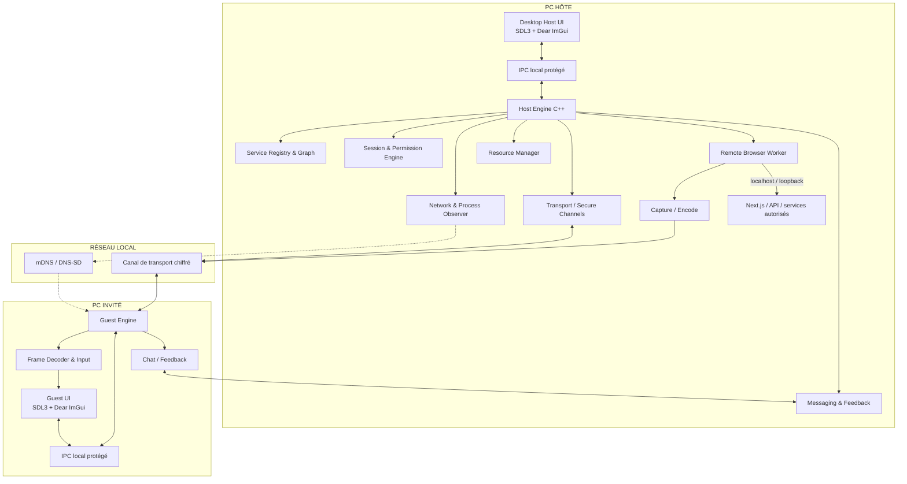
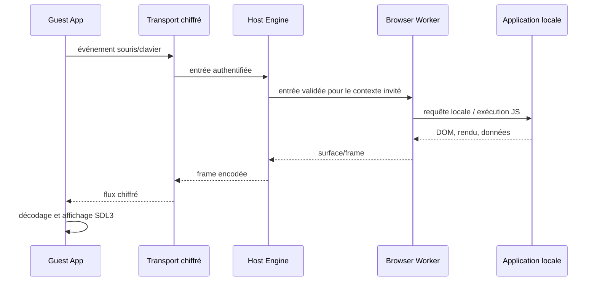
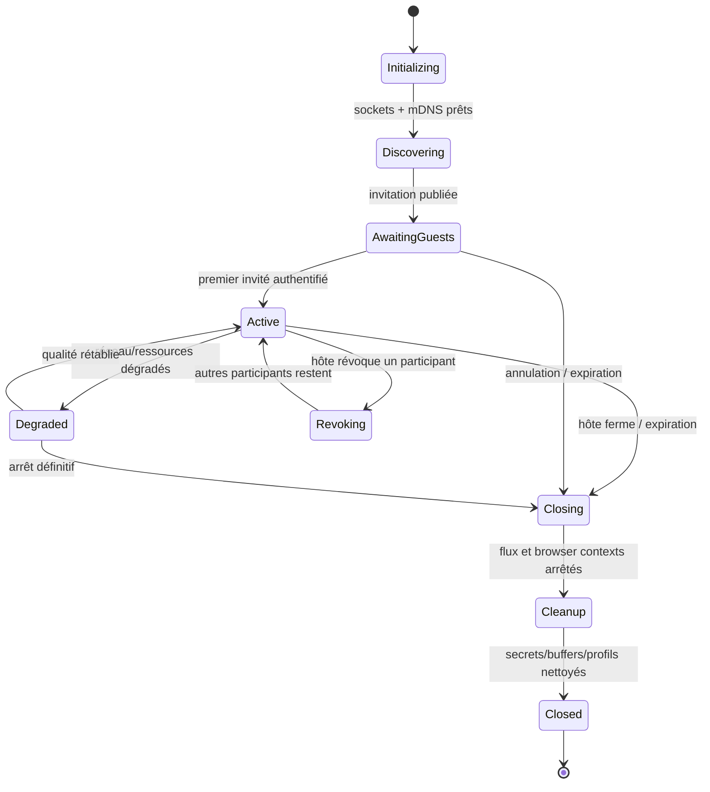
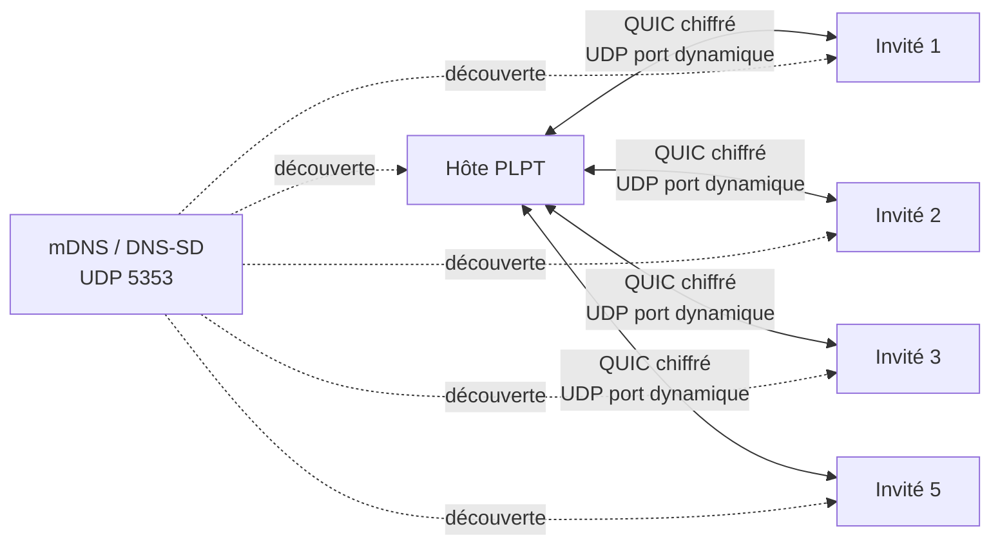

# DOCUMENT MAÎTRE D'ARCHITECTURE

## Plateforme locale de partage et de test collaboratif d'applications

**Nom du produit :** à définir  
**Nom de travail :** PLPT — Plateforme Locale de Partage et de Test  
**Type de document :** vision produit, exigences, architecture système et plan d'ingénierie  
**Version :** 1.0  
**Date :** 12 novembre 2026  
**Statut :** architecture de référence approuvée pour lancement de la phase de conception technique  
**Cible initiale :** Windows x64 ; architecture préparée pour Linux  
**Socle applicatif :** C++20, SDL3, Dear ImGui  

> **Objet du document** — Définir une architecture suffisamment précise pour guider la conception, le découpage du dépôt, les prototypes, le développement et les tests. Ce document est la référence fonctionnelle et technique du projet. Il ne prétend pas que les mécanismes encore à prototyper sont déjà implémentés ni que leurs performances sont démontrées.

---

# 0. Gouvernance du document

## 0.1 Lecteurs visés

- Propriétaire du produit et décideur des arbitrages.
- Architecte logiciel et ingénieurs C++.
- Ingénieurs réseau et sécurité.
- Ingénieurs Windows, Linux et rendu graphique.
- Agent de développement Arena AI chargé d'implémenter les lots qui lui sont confiés.
- Testeurs techniques responsables des tests d'acceptation.

## 0.2 Convention de statut

| Marque | Signification |
|---|---|
| **VALIDÉ** | Décision expressément approuvée par le propriétaire du produit. |
| **RECOMMANDÉ** | Décision d'architecture proposée dans ce document ; à confirmer par un prototype ou une revue technique. |
| **À PROUVER** | Hypothèse qui ne doit pas être considérée comme acquise avant un test instrumenté. |
| **HORS PÉRIMÈTRE V1** | Fonction volontairement repoussée à une version ultérieure. |

## 0.3 Règle de changement

Toute modification d'une décision VALIDÉE doit être consignée sous forme d'une décision d'architecture (ADR) : contexte, options étudiées, décision, conséquences, risques et tests requis. Aucun changement de protocole, de sécurité, de stockage ou de frontière d'accès ne doit être introduit silencieusement.

## 0.4 Principe de vérité technique

PLPT est l’identifiant de travail utilisé dans ce document ; le nom commercial définitif reste à choisir. Les termes « automatique », « isolé », « chiffré », « temporaire », « sans transfert » et « sans accès au PC » ont une définition précise dans ce document. Une fonctionnalité ne peut être déclarée conforme sur la seule base d'une interface graphique ou d'une démonstration nominale : elle doit être vérifiée par des tests de réseau, de processus, de sécurité, de persistance et de concurrence.

---

# 1. Résumé exécutif

PLPT est une application desktop native qui permet à un développeur de rendre temporairement utilisable, par plusieurs personnes, une application exécutée sur son propre ordinateur, sans déployer le projet et sans transférer le dépôt, les fichiers sources ou l'environnement de développement aux invités.

Le développeur démarre ses serveurs avec ses commandes habituelles — par exemple `docker compose up -d`, `npm run dev`, `python -m flask run` ou une commande de son IDE. PLPT observe les ports en écoute, identifie les processus propriétaires et reconstitue, avec un niveau de confiance explicite, leur relation éventuelle avec les terminaux et les projets. Le développeur choisit le point d'entrée à partager et confirme les services réellement nécessaires.

Le mode prioritaire est le **rendu distant exécuté sur l'hôte** : le navigateur de test fonctionne sur le PC du développeur, charge l'application et exécute son JavaScript localement. L'invité reçoit un flux audiovisuel de l'interface et transmet des événements d'interaction. Les ressources Web du projet ne sont donc pas livrées au navigateur de l'invité. L'application invitée n'obtient aucun shell, accès disque, accès au bureau, partage de fichiers, accès à PostgreSQL ou accès réseau général sur la machine hôte.

PLPT est conçu dès le départ pour trois modes de participation :

1. **Test indépendant** : chaque invité possède son contexte de navigation et son état de session séparés.
2. **Collaboration sur une vue** : plusieurs participants observent la même page ; un seul contrôle l'interface à un instant donné, avec transfert explicite du contrôle.
3. **Observation seule** : les invités visualisent sans envoyer d'événements de contrôle.

Une messagerie intégrée accompagne chaque session : discussion générale, messages privés, présence, accusés de lecture, réactions, mentions, épinglage et remontée contextuelle d'anomalies. Le contenu de session est temporaire et conservé en mémoire par défaut.

Le projet est développé autour d'un cœur C++20, d'une interface SDL3 + Dear ImGui, d'adaptateurs natifs Windows/Linux, d'un moteur de découverte, d'un moteur de transport sécurisé, d'un gestionnaire de sessions, d'un moteur de rendu distant et d'un moteur de ressources. Le réseau local est la première cible. Le fonctionnement entre réseaux différents nécessitera ensuite une infrastructure de coordination et de relais contrôlée par le propriétaire du produit ; aucun service de tunnel tiers n'est retenu.

## 1.1 Résultat produit attendu

Un développeur peut :

1. ouvrir PLPT ;
2. voir les serveurs locaux détectés, notamment ceux lancés depuis un terminal ;
3. sélectionner le serveur Web principal et valider les dépendances ;
4. créer une session et inviter plusieurs personnes ;
5. voir les invités se connecter dans l'application PLPT installée chez eux ;
6. laisser chaque invité tester l'application ou organiser un test collectif ;
7. discuter et recueillir des rapports d'anomalie dans la même session ;
8. révoquer un participant ou fermer la session ;
9. constater que les canaux sont fermés et les données temporaires supprimées selon la politique définie.

## 1.2 Scénario de validation directeur

Un développeur démarre Next.js et Supabase localement avec Docker. PLPT détecte le port Web de Next.js, le processus Node.js, les processus parents et les services Docker publiés. Le développeur choisit le point d'entrée de la marketplace et confirme les origines API nécessaires. Il invite cinq testeurs sur le même réseau Wi-Fi. Chaque testeur ouvre la marketplace dans PLPT, avec son propre contexte de navigateur. Les testeurs utilisent des comptes différents, communiquent par messagerie et peuvent signaler une anomalie. L'hôte garde la maîtrise des accès. À la fermeture, les profils temporaires et les données de session sont supprimés au mieux selon les garanties documentées.

Ce scénario est le **test d'acceptation de bout en bout prioritaire**. Les autres fonctions ne doivent pas retarder sa réalisation.

---

# 2. Vision, objectifs et principes non négociables

## 2.1 Vision

Faire d'une application locale une cible de test collaborative temporaire, accessible depuis une autre installation de PLPT, avec une expérience d'utilisation proche d'une application déployée, tout en gardant le code, les serveurs et les données de développement sur la machine de l'hôte.

## 2.2 Objectifs du produit

- Supprimer la nécessité de déployer une application simplement pour obtenir un retour d'un autre utilisateur.
- Éviter le transfert du dépôt Git, des sources, des fichiers `.env` et des dépendances du projet.
- Éviter d'exiger de l'invité Node.js, Docker, Python, un IDE ou une commande terminal.
- Détecter et présenter les services locaux de façon claire, y compris les processus lancés depuis des terminaux et IDE.
- Permettre des tests indépendants et des démonstrations collectives avec plusieurs invités.
- Intégrer la communication et la remontée de bugs au flux de test.
- Réduire au minimum la surface réseau ouverte sur le PC hôte.
- Construire un produit contrôlé par son propriétaire, sans fournisseur de tunnel ou de relais imposé.

## 2.3 Principes non négociables

1. **Pas d'accès général au PC hôte.** L'invité ne reçoit ni shell, ni accès bureau, ni partage de fichiers, ni exploration de dossiers.
2. **Pas de transfert du projet.** Le dépôt, les fichiers sources, les secrets de développement et les dossiers de travail ne sont jamais envoyés à l'invité.
3. **Rendu côté hôte par défaut.** Le navigateur de test s'exécute sur l'hôte ; l'invité reçoit des images/frames et envoie des événements d'interaction.
4. **Autorisation explicite.** Aucun port ou service n'est partageable simplement parce qu'il a été détecté.
5. **Moindre privilège.** PLPT fonctionne sous le compte utilisateur courant, sans élévation permanente.
6. **Sessions temporaires.** Les clés, profils et contenus de session ont une durée de vie définie et un nettoyage vérifiable.
7. **Réseau local d'abord.** La V1 doit fonctionner sans Internet, serveur central ni service de tunnel tiers sur un LAN compatible.
8. **Multi-invités dès le socle.** Les sessions, le transport, les ressources et la messagerie ne seront pas conçus comme un simple tête-à-tête.
9. **Standards pour les fondations.** Ne pas réinventer TCP/IP, les primitives cryptographiques, TLS, QUIC ou un navigateur Web complet.
10. **Moteur propriétaire.** La découverte, les règles de partage, la gestion des sessions, le protocole applicatif PLPT, le contrôle des invités, la messagerie et l'interface sont conçus pour PLPT.

## 2.4 Définition précise du « from scratch »

« From scratch » signifie que PLPT ne repose pas sur un logiciel de partage ou un service de tunnel tiers qui prend en charge le produit à notre place. Les moteurs applicatifs et la logique métier du produit sont développés pour PLPT.

Cela ne signifie pas réécrire les couches réseau et cryptographiques éprouvées ni réécrire tout le moteur HTML/CSS/JavaScript. Le projet doit utiliser les interfaces natives du système et des implémentations maintenues de standards lorsque la sécurité et l'interopérabilité l'exigent. Les dépendances autorisées doivent être inventoriées, versionnées, auditées et isolées derrière des interfaces.

---

# 3. Périmètre produit

## 3.1 Inclus dans la trajectoire V1

- Application desktop native avec modes hôte et invité.
- Windows x64 comme plateforme de référence initiale.
- Architecture préparée pour Linux.
- Interface SDL3 + Dear ImGui.
- Découverte de ports TCP et UDP locaux.
- Association port/processus/PID et arbre de processus.
- Association probable à un terminal ou IDE, avec indicateur de confiance.
- Détection des services conteneurisés via adaptateur Docker en lecture seule et opt-in.
- Sélection du point d'entrée d'une application.
- Configuration/confirmation des services et origines réseau nécessaires au navigateur hôte.
- Découverte LAN et invitations temporaires.
- Transport sécurisé avec ports de données attribués dynamiquement.
- Rendu distant exécuté sur l'hôte.
- Profils de navigateur séparés par invité.
- Modes test indépendant, collaboration et observation seule.
- Messagerie de session et remontée de bugs.
- Gestion des ressources, de la qualité vidéo et des reconnexions.
- Arrêt, révocation et nettoyage.

## 3.2 Prévu après validation de la V1 LAN

- Connexion entre réseaux différents.
- Infrastructure de signalisation et relais auto-hébergée par le propriétaire.
- Adaptateurs Linux complets et parité fonctionnelle.
- Audio/vidéo en direct entre participants.
- Environnements backend isolés ou clonés par groupe/testeur.
- Historique de retours exportable, si l'hôte l'autorise.
- Scénarios de test automatisés et annotations avancées.

## 3.3 Hors périmètre V1

- Bureau à distance généraliste.
- Terminal distant ou exécution de commandes sur l'hôte.
- Transfert de fichiers arbitraires.
- Synchronisation de code ou de dépôt.
- Publication permanente d'une application sur Internet.
- Accès direct de l'invité à PostgreSQL, au moteur Docker, à Supabase Studio ou aux panneaux d'administration locaux.
- Contrôle de l'ordinateur hôte au-delà de la fenêtre de navigateur isolée.
- Stockage cloud obligatoire des données de session.
- Appels audio/vidéo.

---

# 4. Acteurs, permissions et scénarios d'utilisation

## 4.1 Acteurs

| Acteur | Responsabilités | Limites |
|---|---|---|
| Hôte / développeur | Détecte les services, choisit le point d'entrée, crée la session, invite, modère et ferme. | Ne doit pas exposer accidentellement les services internes. |
| Testeur | Utilise une instance de navigateur distante indépendante et envoie des retours. | Aucun accès système à l'hôte ; aucun fichier du projet. |
| Collaborateur | Participe à une vue partagée et peut prendre le contrôle lorsqu'il y est autorisé. | Un seul contrôleur actif à la fois pour une vue partagée. |
| Observateur | Visualise la session et échange dans le chat. | Aucun événement clavier/souris envoyé au navigateur. |
| Administrateur local du PC | Gère les politiques OS, pare-feu et droits. | PLPT ne doit pas contourner les politiques de sécurité locales. |

## 4.2 Rôles et permissions

Les rôles sont des profils de permissions, pas des comptes Windows.

| Permission | Hôte | Testeur indépendant | Collaborateur | Observateur |
|---|---:|---:|---:|---:|
| Voir le flux de son contexte | Oui | Oui | Oui | Oui |
| Contrôler son contexte | Oui | Oui | Selon jeton de contrôle | Non |
| Contrôler la vue collaborative | Oui | Non | Oui, si verrou obtenu | Non |
| Chat général | Oui | Oui | Oui | Oui |
| Message privé | Oui | Oui | Oui | Oui |
| Signaler un bug | Oui | Oui | Oui | Oui |
| Inviter d'autres personnes | Oui | Non | Non par défaut | Non |
| Modifier les services partagés | Oui | Non | Non | Non |
| Révoquer une invitation | Oui | Non | Non | Non |
| Fermer la session | Oui | Non | Non | Non |

## 4.3 Parcours nominal de l'hôte

1. L'hôte ouvre PLPT.
2. Le moteur d'observation démarre sans privilège administrateur.
3. Les ports en écoute et processus sont recensés.
4. Les services candidats sont regroupés par arbre de processus, chemin de travail, métadonnées et indices Docker.
5. L'hôte choisit un service Web et confirme le point d'entrée.
6. PLPT vérifie que le serveur est joignable depuis la machine hôte.
7. PLPT propose les dépendances observées ou configurées ; l'hôte confirme les origines nécessaires.
8. L'hôte choisit le mode de test, la capacité maximale et les permissions.
9. PLPT réserve ses endpoints de transport, annonce le service sur le LAN et crée une invitation à usage limité.
10. Les invités sont authentifiés et affectés à des contextes indépendants ou à une vue partagée.
11. L'hôte surveille les connexions, les ressources, les erreurs et les messages.
12. L'hôte révoque un invité ou ferme la session.

## 4.4 Parcours nominal de l'invité

1. L'invité installe et ouvre PLPT ; aucune commande externe n'est requise.
2. Il rejoint une session par découverte LAN ou invitation.
3. Il confirme l'identité de l'hôte et accepte l'invitation.
4. PLPT établit un canal authentifié et chiffré.
5. L'application affiche le flux de la marketplace ou application choisie.
6. L'invité clique, saisit et navigue ; les événements sont transmis au navigateur distant.
7. Il utilise le chat et peut signaler un problème.
8. À la fermeture, les buffers, profils de session côté invité et secrets temporaires sont libérés ; aucun contenu du projet n'est conservé sur le PC invité par PLPT.

---

# 5. Exigences fonctionnelles

Les exigences ci-dessous sont identifiées pour être testables. Une exigence ne peut être déclarée terminée qu'avec un test associé.

## 5.1 Découverte des services

| ID | Exigence | Priorité |
|---|---|---|
| FR-DIS-001 | Détecter les endpoints TCP en écoute IPv4 et IPv6. | P0 |
| FR-DIS-002 | Détecter les endpoints UDP locaux et les distinguer des listeners TCP. | P0 |
| FR-DIS-003 | Associer chaque endpoint à un PID lorsque l'OS l'autorise. | P0 |
| FR-DIS-004 | Inventorier le nom de processus, le PID et le PID parent. | P0 |
| FR-DIS-005 | Construire un arbre de processus avec indication des données manquantes. | P0 |
| FR-DIS-006 | Déduire le terminal/IDE probable à partir des ancêtres et métadonnées accessibles. | P1 |
| FR-DIS-007 | Afficher le niveau de confiance de l'association à un projet/terminal. | P1 |
| FR-DIS-008 | Mettre à jour l'inventaire sans scan agressif continu. | P0 |
| FR-DIS-009 | Présenter les services Docker publiés via un adaptateur optionnel, en lecture seule. | P1 |
| FR-DIS-010 | Ne pas confondre un port lié UDP, un port TCP en écoute et une connexion sortante. | P0 |

## 5.2 Sélection et autorisation

| ID | Exigence | Priorité |
|---|---|---|
| FR-SHR-001 | L'hôte sélectionne explicitement un point d'entrée Web. | P0 |
| FR-SHR-002 | Les services détectés ne sont jamais partagés par défaut. | P0 |
| FR-SHR-003 | L'hôte confirme les origines/ports que le navigateur distant est autorisé à joindre. | P0 |
| FR-SHR-004 | Les bases de données, consoles d'administration et sockets internes sont non exposés par défaut. | P0 |
| FR-SHR-005 | L'hôte peut révoquer un invité individuellement. | P0 |
| FR-SHR-006 | L'hôte peut suspendre ou fermer toute la session. | P0 |
| FR-SHR-007 | Les sessions possèdent une expiration configurable. | P1 |

## 5.3 Multi-invités

| ID | Exigence | Priorité |
|---|---|---|
| FR-MUL-001 | Accepter plusieurs invités dans une même session hôte. | P0 |
| FR-MUL-002 | Créer un profil de navigateur isolé pour chaque testeur indépendant. | P0 |
| FR-MUL-003 | Fournir une vue collaborative avec verrou de contrôle unique. | P1 |
| FR-MUL-004 | Fournir un rôle observation seule. | P1 |
| FR-MUL-005 | Afficher l'état connecté, inactif, reconnexion et déconnecté. | P0 |
| FR-MUL-006 | Limiter la capacité en fonction des ressources disponibles et de la limite hôte. | P0 |
| FR-MUL-007 | Préserver l'isolation des cookies, du stockage local et de l'historique de chaque profil. | P0 |

## 5.4 Messagerie et feedback

| ID | Exigence | Priorité |
|---|---|---|
| FR-MSG-001 | Fournir une discussion générale de session. | P0 |
| FR-MSG-002 | Fournir les messages privés entre participants. | P1 |
| FR-MSG-003 | Gérer présence, saisie en cours et accusés de lecture. | P1 |
| FR-MSG-004 | Gérer réponses, réactions, mentions et épinglage. | P1 |
| FR-MSG-005 | Permettre un signalement d'anomalie contextualisé. | P0 |
| FR-MSG-006 | Permettre d'attacher une capture uniquement après action explicite. | P1 |
| FR-MSG-007 | Ne pas conserver le contenu des conversations après fermeture, sauf décision future explicite. | P0 |
| FR-MSG-008 | Ne pas autoriser les pièces jointes arbitraires en V1. | P0 |

## 5.5 Rendu distant

| ID | Exigence | Priorité |
|---|---|---|
| FR-RND-001 | Exécuter le navigateur de test sur l'hôte. | P0 |
| FR-RND-002 | Transmettre les images/frames au client invité sans lui envoyer les ressources Web du projet. | P0 |
| FR-RND-003 | Transmettre les événements de souris et clavier avec ordre et validation. | P0 |
| FR-RND-004 | Supporter redimensionnement, DPI, navigation, redirections et WebSockets locaux. | P0 |
| FR-RND-005 | Interdire par défaut téléchargements, presse-papiers, fichiers locaux et protocoles externes. | P0 |
| FR-RND-006 | Empêcher toute navigation hors des origines autorisées. | P0 |
| FR-RND-007 | Détruire le contexte de navigateur temporaire à la fin de session. | P0 |

---

# 6. Exigences non fonctionnelles et objectifs de qualité

Les valeurs ci-dessous sont des **objectifs initiaux à mesurer**, pas des performances garanties avant prototype.

| Domaine | Objectif initial | Méthode de mesure |
|---|---|---|
| Démarrage | Interface exploitable en moins de 3 s sur machine de référence. | Mesure lancement -> première interaction. |
| Découverte | Détection initiale des endpoints en moins de 2 s sur machine normale. | Tests répétables avec 20/100/500 sockets. |
| Join LAN | Première image en moins de 5 s après validation de l'invitation. | Chronométrage E2E. |
| Latence d'interaction | Cible p95 inférieure à 150 ms sur Wi-Fi local sain. | Horodatages entrée -> frame confirmant l'effet. |
| Fluidité | 30 FPS cible à 720p pour un invité actif ; adaptation en cas de charge. | Statistiques encode/décode/perte. |
| Messagerie | Livraison p95 inférieure à 250 ms sur LAN sain. | Horodatage client/serveur. |
| Capacité | Scénario de référence de 5 invités indépendants. | Profiling CPU/GPU/RAM/bande passante. |
| Sécurité | Aucun accès hors des capacités explicitement autorisées. | Tests négatifs et revue de menace. |
| Persistance | Aucun contenu de session écrit durablement par le client invité. | Traces fichiers, profil, logs et crash dumps. |
| Résilience | Reconnexion contrôlée après perte réseau temporaire. | Injection de perte, déconnexion/reconnexion Wi-Fi. |
| Portabilité | Abstraction plateforme permettant un backend Linux sans réécrire le cœur métier. | Tests de compilation et interfaces. |

## 6.1 Performance adaptative

La qualité vidéo est adaptative : résolution, fréquence d'images, quantification/bitrate et cadence d'envoi varient selon le réseau et la charge de l'hôte. La priorité est la réactivité des interactions, pas la conservation de chaque frame. Les frames obsolètes doivent être abandonnées plutôt que mises en file indéfiniment.

## 6.2 Capacité et vérité produit

« Cinq invités » est le scénario de référence initial. Le nombre maximal réel dépend du processeur, du GPU, de la mémoire, du moteur navigateur, du codec et du réseau. PLPT doit refuser proprement une nouvelle session si la capacité est dépassée, plutôt que promettre un nombre universel d'invités.

---

# 7. Architecture logique globale

## 7.1 Vue d'ensemble



## 7.2 Processus applicatifs

### Desktop UI

- SDL3 gère fenêtre, entrées, événements, DPI et cycle de vie.
- Dear ImGui fournit les écrans de gestion, de session, de participants, de ports et de messagerie.
- Le backend de rendu peut être SDL_GPU ou Vulkan selon le choix de plateforme et les tests.
- L'interface ne possède pas les sockets de transport ni les privilèges de gestion du moteur.

### Host Engine

Processus logique chargé de découverte, autorisation, sessions, transport, rendu distant, messagerie et ressources. Il s'exécute sous le compte utilisateur courant. Pas de service Windows élevé en V1.

### Guest Engine

Composant interne automatiquement lancé par l'application invitée. Il gère connexion, déchiffrement, décodage, envoi d'entrées et messagerie. L'utilisateur invité ne lance aucune commande et n'installe aucun outil de développement supplémentaire.

### Browser Worker

Composant isolé côté hôte. Il exécute le navigateur Web de test et le contexte d'un invité ou d'une vue partagée. Il ne doit pas avoir accès arbitraire au système de fichiers ni au réseau local complet.

## 7.3 Séparation par frontières de confiance

- Interface desktop -> moteur : IPC local authentifié/ACL utilisateur.
- Moteur -> navigateur : IPC local spécifique au contexte ; aucune API fichier générale.
- Hôte -> invité : transport authentifié et chiffré.
- Invité -> hôte : messages typés, événements navigateur filtrés et captures explicitement autorisées.
- Navigateur -> services projet : requêtes exécutées localement sur l'hôte et limitées aux origines explicitement autorisées.

---

# 8. Architecture modulaire détaillée

## 8.1 `platform/`

Responsabilité : adapter les opérations système sans contaminer le cœur métier.

Interfaces conceptuelles :

- `IProcessEnumerator`
- `ISocketTableProvider`
- `INetworkInterfaceProvider`
- `ILocalIpcServer` / `ILocalIpcClient`
- `IFirewallPromptAdapter`
- `IClock` / `IRandomSource`
- `ITemporaryStorage`
- `IUserIdentityProvider`

Backends initiaux : `platform/windows/`, puis `platform/linux/`.

Le cœur reçoit des structures normalisées (PID, endpoint, état, identifiant d'interface, chemin exécutable facultatif). Il ne doit pas appeler directement l'API Windows depuis les règles de session.

## 8.2 `discovery/`

Sous-modules :

- `socket_observer` : endpoints TCP/UDP.
- `process_snapshot` : processus, PID, PPID, nom et chemin accessibles.
- `process_tree` : liens parent-enfant et détection de disparition/réutilisation PID.
- `terminal_classifier` : heuristiques PowerShell, CMD, Windows Terminal, IDE, shells Linux.
- `container_adapter` : métadonnées de ports publiés par Docker, en lecture seule et opt-in.
- `confidence` : score et motifs expliquant l'association proposée.

La détection d'un terminal est une **inférence**. Un enfant Node peut être lancé depuis npm, un IDE, un gestionnaire de tâches ou un service. L'interface doit afficher « origine probable » et jamais affirmer une filiation lorsqu'elle n'est pas démontrée.

Ne pas lire l'historique du terminal, les frappes clavier, les variables d'environnement sensibles ou les fichiers `.env` pour détecter le contexte.

## 8.3 `service_registry/`

Tient un inventaire stable des services détectés : endpoint, protocole, processus, conteneur éventuel, projet probable, origine, niveau de confiance, première/dernière observation et état.

Un service est une entité logique ; un port n'est qu'un endpoint. Un processus peut posséder plusieurs ports ; un projet peut utiliser plusieurs processus ; Docker peut publier un port qui est relayé par un proxy système. Le modèle ne doit pas imposer une relation 1:1.

## 8.4 `service_graph/`

Construit un graphe de dépendances proposé à l'hôte à partir de :

- Origines configurées par l'hôte.
- Variables d'URL non secrètes, uniquement lorsque l'hôte les saisit ou autorise une lecture ciblée ; pas de collecte globale de `.env`.
- Métadonnées Docker et ports publiés.
- Origine et port effectivement utilisés par le navigateur de test lors d'une phase de diagnostic contrôlée.
- Configuration de projet déclarée manuellement.

Le graphe peut suggérer que la page Next.js contacte Supabase API, mais l'hôte doit confirmer les origines. Il ne doit pas automatiquement exposer PostgreSQL ou Supabase Studio.

## 8.5 `port_allocator/`

Gère les endpoints de transport de PLPT, pas les ports du projet. Utilise l'allocation du système d'exploitation : socket créé, bind sur port 0, récupération du port attribué, socket conservé ouvert. Sur Windows, configurer la stratégie d'exclusivité avant `bind` et éviter `SO_REUSEADDR` pour les listeners unicast ordinaires. Les références Microsoft décrivent le bind à port zéro, `getsockname` et les risques d'un partage de port non exclusif [R4][R5][R6].

Politique de base :

- Un endpoint UDP dynamique pour le transport QUIC.
- Un endpoint TCP dynamique de secours seulement si le prototype démontre sa nécessité et si le protocole de secours est spécifié.
- Pas de port par invité.
- Pas de port par service projet.
- Pas de troisième listener ouvert sans besoin fonctionnel démontré.
- mDNS/DNS-SD UDP 5353 est une exception standard de découverte LAN, pas un port de données applicatives choisi par PLPT [R7][R8].

Le gestionnaire conserve les sockets ouverts pendant toute la durée où les endpoints sont annoncés. Il ne fait pas « vérifier libre puis bind plus tard » : cette séquence serait sujette à une course TOCTOU.

## 8.6 `transport/`

Couche de transport indépendante du protocole applicatif. Le choix recommandé pour le canal principal est QUIC sur UDP, pour ses flux multiplexés et sa sécurité intégrée avec TLS. Les frames temps réel peuvent utiliser l'extension QUIC DATAGRAM après négociation ; chat, contrôle et signalisation utilisent des flux fiables. Références : RFC 9000 et RFC 9221 [R9][R10].

Le protocole PLPT définit ses propres types de messages au-dessus du transport. Il ne redéfinit pas le chiffrement ou les retransmissions QUIC.

## 8.7 `session/`

Fonctions :

- création et fermeture de session ;
- invitations à usage unique ;
- authentification de chaque invité ;
- gestion des rôles et capacités ;
- expiration, renouvellement et révocation ;
- présence et états de connexion ;
- réassociation à la bonne vue de navigateur ;
- reprise contrôlée après coupure.

La session est l'unité d'autorisation centrale. Aucun accès ne doit être accordé uniquement parce qu'une personne connaît un port ou découvre un service mDNS.

## 8.8 `browser_runtime/`

Définit une interface `IRemoteBrowserBackend` indépendante du fournisseur de moteur Web.

Capacités minimales :

- créer et détruire un contexte temporaire ;
- créer un profil isolé par invité ;
- naviguer vers une origine approuvée ;
- recevoir les événements de navigation ;
- intercepter demandes réseau, redirections et fenêtres ;
- transmettre les entrées autorisées ;
- fournir un flux visuel capturable ;
- désactiver ou contrôler téléchargement, clipboard, drag/drop, permissions, stockage et protocoles externes.

**Prototype Windows recommandé :** évaluer WebView2 via son contrôleur de composition et ses profils distincts. Microsoft documente le rendu par composition, la réception des entrées et les profils multiples ; les données utilisateur WebView2 comprennent cookies, permissions et caches [R12][R13]. Cette dépendance est un moteur Web, pas un service de partage. Elle doit être déclarée et versionnée. La faisabilité d'une capture stable, basse latence et exploitable à distance doit être démontrée avant validation définitive.

Si le critère « from scratch » devait interdire même un moteur Web système, il faudrait développer un moteur HTML/CSS/JavaScript complet : ce choix est hors d'échelle pour la V1 et incompatible avec une fidélité Web moderne. L'architecture conserve donc un adaptateur remplaçable.

## 8.9 `capture_encode/` et `decode_render/`

Côté hôte : capture de la sortie du navigateur, conversion vers une surface vidéo, encodage matériel si disponible, encodeur logiciel de secours, adaptation de qualité et gestion des keyframes.

Côté invité : décodage, synchronisation, composition dans l'interface SDL3/ImGui et transmission d'entrées.

Le backend Windows devra évaluer Windows Graphics Capture ou la capture de surface/visual tree du moteur Web. Windows Graphics Capture est une API de capture de frames d'une fenêtre ou d'un écran, mais les restrictions de visibilité, le choix de fenêtre et le comportement en arrière-plan doivent être testés [R14].

## 8.10 `messaging/`

- Canaux généraux et privés.
- Messages texte limités en taille.
- Présence, saisie, accusés de lecture.
- Réactions, mentions, réponses et épinglage.
- Feedback contextualisé : URL logique/page, heure, participant, navigateur, résolution, capture optionnelle.
- Modération : suppression/masquage dans la session et révocation du participant.
- Rétention mémoire jusqu'à fermeture.

Le chiffrement de transport protège les messages contre l'écoute sur le LAN. Dans la V1, l'hôte est l'un des endpoints et peut donc lire les messages ; le chiffrement n'est pas présenté comme un chiffrement de bout en bout opaque à l'hôte. Un mode E2EE entre invités pourra faire l'objet d'un ADR ultérieur.

## 8.11 `resource_manager/`

Mesure CPU, mémoire, GPU, encodeur, nombre de profils, débit réseau et longueur des files d'attente. Peut réduire résolution/FPS/bitrate, mettre en pause les vues inactives et refuser les nouveaux invités au-delà de la capacité cible.

## 8.12 `audit_telemetry/`

Journalise les événements techniques minimaux : création de session, connexion, révocation, changement de rôle, port choisi, erreur, fermeture. Ne journalise pas le contenu de l'écran, les frappes clavier, le texte du chat ni les requêtes contenant des secrets. Les logs locaux sont désactivables/exportables et expurgés des identifiants secrets.

---

# 9. Détection des ports, processus et terminaux

## 9.1 Règle fondamentale

Un port n'est pas « celui du terminal ». Le processus serveur détient l'endpoint ; le terminal/IDE est parfois un ancêtre du processus. PLPT doit présenter cette distinction sans ambiguïté.

Exemple de chaîne possible :

```text
Windows Terminal
  └─ PowerShell
      └─ npm.cmd / node.exe
          └─ serveur Next.js (TCP 3000)
```

Cette chaîne est informative mais non garantie : `npm`, les IDE, les wrappers, les processus de build et les conteneurs peuvent modifier la filiation observée.

## 9.2 Windows — sources natives

- `GetExtendedTcpTable` pour les endpoints TCP et l'information de propriétaire selon la classe demandée [R1].
- `GetExtendedUdpTable` pour les endpoints UDP et leur propriétaire [R2].
- `CreateToolhelp32Snapshot`, `Process32First` et `Process32Next` pour les processus, PID et PID parent [R3].
- APIs complémentaires pour le chemin exécutable et la ligne de commande lorsque les droits le permettent. Les données inaccessibles restent nulles/masquées ; aucun contournement de permission.

Le service d'observation doit tolérer les processus qui disparaissent pendant la lecture, les PID réutilisés, les erreurs d'accès et les changements d'état entre deux snapshots.

## 9.3 Linux — backend ultérieur

Approche à confirmer : interfaces netlink de diagnostic socket, `/proc` pour association socket/inode/processus, arbre processus et métadonnées de session. Les permissions et espaces de noms conteneur doivent être traités explicitement. L'implémentation Linux ne doit pas être un simple portage des API Windows.

## 9.4 Découverte des terminaux

Le classificateur doit :

- examiner la relation PPID et les noms de processus ;
- distinguer terminal, shell, IDE et runner ;
- détecter les cas où le parent a disparu ;
- présenter plusieurs origines possibles si ambigu ;
- afficher un niveau de confiance (élevé/moyen/faible) avec les indices utilisés ;
- permettre une correction manuelle par l'hôte.

Il ne doit pas collecter l'historique de commande, les frappes, les variables d'environnement complètes ni les secrets.

## 9.5 Docker et environnements virtualisés

Dans Docker Desktop/WSL2, le PID visible dans Windows peut être un proxy système plutôt que le processus réel du conteneur. Un adaptateur Docker en lecture seule peut relier un port publié à un conteneur et à ses métadonnées. Connexion au moteur Docker = capacité puissante : elle doit être opt-in, limitée aux lectures nécessaires et désactivée par défaut si l'API disponible implique des droits trop larges.

## 9.6 Cadence

- Snapshot initial à l'ouverture.
- Rafraîchissement adaptatif, cible 1–2 secondes lorsque la vue est active.
- Ralentissement lorsque la fenêtre est en arrière-plan.
- Détection de changement par comparaison d'identités de socket et de processus.
- Aucun scan de ports distant du LAN.

## 9.7 UX obligatoire

Chaque ligne de port montre : protocole, adresse locale, port, état, PID, nom exécutable, origine probable, projet probable, niveau de confiance, et état de partage. Un endpoint détecté doit porter l'un des états : `Détecté`, `Candidat`, `Sélectionné`, `Autorisé`, `Protégé`, `Indisponible` ou `Disparu`.

---

# 10. Stratégie de ports et découverte LAN

## 10.1 Ne pas confondre ports du produit et ports du projet

- **Ports projet** : ports déjà utilisés par Next.js, Vite, Flask, Supabase, Docker, etc. PLPT les observe et ne les réserve pas.
- **Ports internes PLPT** : ports de transport de l'application PLPT. Ils sont alloués dynamiquement par l'OS.
- **Port standard de découverte** : UDP 5353 pour mDNS, protocole standard de découverte locale [R7].

SDL3 et Dear ImGui ne nécessitent pas de port réseau pour créer et afficher l'interface desktop. Une collision avec un port de projet n'a donc aucun rapport avec le rendu graphique de la fenêtre PLPT.

## 10.2 Allocation dynamique correcte

Le gestionnaire ne choisit pas un nombre de port au hasard et ne fait pas un scan « port libre » suivi d'un bind ultérieur. Il demande directement au système :

1. créer un socket UDP ou TCP ;
2. configurer l'exclusivité avant le bind si le système le permet ;
3. binder sur le port `0` ;
4. lire le port effectivement attribué avec `getsockname` ;
5. conserver le socket ouvert tant que l'endpoint est annoncé ;
6. publier l'endpoint dans l'enregistrement de découverte.

Sur Winsock, `bind` avec port zéro demande au fournisseur d'attribuer un port de la plage dynamique ; `getsockname` permet de lire l'association locale [R4][R5]. `SO_EXCLUSIVEADDRUSE` doit être configuré avant `bind` pour éviter les comportements de partage de port non maîtrisés ; l'utilisation générale de `SO_REUSEADDR` pour les listeners unicast est proscrite [R6].

## 10.3 Nombre d'endpoints recommandé

- Un listener UDP dynamique pour QUIC en mode LAN.
- Un listener TCP dynamique de secours, uniquement si les tests démontrent une valeur opérationnelle.
- mDNS UDP 5353 pour découvrir le service, ou intégration à un résolveur/DNS-SD natif lorsque disponible.
- Pas de listener par invité, par onglet ou par service de projet.

Un troisième endpoint applicatif n'est pas ajouté par précaution : chaque socket exposé élargit la surface d'attaque. La redondance doit être obtenue par un mécanisme de rebind et de reprise, pas par l'ouverture de ports inutiles.

## 10.4 Basculement automatique

**Avant publication :** si la création ou le bind échoue, le socket est détruit et l'OS est sollicité à nouveau avec port zéro. Aucun numéro de port fixe n'est essayé en boucle.

**Après publication :** si le listener devient inutilisable, PLPT crée un nouveau socket dynamique, teste son fonctionnement, publie un nouvel enregistrement, conserve l'ancien endpoint aussi longtemps que possible et demande aux clients de basculer avec un jeton de reprise. L'ancien endpoint n'est fermé qu'après migration/reconnexion ou expiration du délai.

Ne pas promettre une migration serveur QUIC transparente dans tous les cas : QUIC v1 autorise la migration de chemin sous certaines conditions mais ne fournit pas une relocalisation arbitraire et transparente d'un serveur vers un nouveau port. Le basculement PLPT est donc un protocole applicatif de double écoute/reprise, avec reconnexion sécurisée si nécessaire [R9].

## 10.5 mDNS/DNS-SD

La découverte LAN utilise DNS-SD pour annoncer un service PLPT avec son nom, sa version, son adresse et le port dynamique. mDNS utilise le port standard UDP 5353 et des adresses multicast link-local [R7][R8].

Les enregistrements mDNS ne sont **pas une preuve d'identité**. Ils peuvent être falsifiés ou manipulés sur un LAN. L'invité doit toujours vérifier l'identité cryptographique de l'hôte et accepter une invitation valide.

Un service mDNS déjà présent sur le système est un cas à traiter. Le prototype devra tester le partage correct du port multicast avec les services du système. PLPT ne doit pas adopter `SO_REUSEADDR` de manière aveugle : les règles de réutilisation de port sont différentes pour multicast et unicast et peuvent rendre le routage non déterministe dans d'autres cas [R6].

## 10.6 Pare-feu

Le système d'exploitation peut bloquer les connexions entrantes même si le port est libre et correctement lié. PLPT doit expliquer le besoin et demander l'autorisation via les mécanismes normaux du système. Il ne doit pas désactiver le pare-feu ni créer silencieusement des règles larges. Les règles, si elles sont autorisées, sont limitées à l'exécutable, au profil réseau privé et au protocole/port nécessaires.

---

# 11. Transport et protocole applicatif PLPT

## 11.1 Transport recommandé

QUIC sur UDP est le candidat principal : multiplexage de flux fiables, faible latence de connexion et migration de chemin ; les connexions QUIC sont protégées par son intégration TLS [R9]. L'extension DATAGRAM de QUIC permet des datagrammes non retransmis pour des données temps réel [R10].

Le choix d'une implémentation QUIC doit être un ADR technique : bibliothèque maintenue, licence, sécurité, disponibilité Windows/Linux, intégration C++, coût de maintenance et tests d'interopérabilité. PLPT ne doit pas réimplémenter QUIC pour revendiquer du « from scratch ».

TLS 1.3 doit suivre la spécification courante RFC 9846 (juillet 2026), qui remplace RFC 8446 [R11]. Les paramètres cryptographiques concrets sont confiés à la pile de transport et à des fournisseurs cryptographiques audités.

## 11.2 Multiplexage logique

Une connexion invité-hôte transporte plusieurs flux logiques :

| Flux logique | Fiabilité | Priorité | Contenu |
|---|---|---:|---|
| Contrôle/session | Fiable, ordonné | Très haute | Auth, rôles, fermeture, reprise, capacités. |
| Entrées clavier | Fiable, ordonné | Très haute | Key down/up, texte, IME. |
| Entrées pointeur | Dernier état prioritaire ; pertes tolérées pour mouvement | Haute | Mouvement, clic, molette, tactile. |
| Vidéo | Datagrams/pertes tolérées avec contrôle d'image | Haute | Frames encodées, keyframes, timestamps. |
| Messagerie | Fiable, ordonné | Moyenne-haute | Messages, accusés, réactions. |
| Présence/telemetry | Coalescée, éventuellement non fiable | Moyenne | Heartbeats, stats, état ressource. |

Une perte de mouvement souris ne doit pas bloquer les messages ou l'affichage. Un événement key-up ne peut pas être perdu sans récupération ; les états clavier doivent être réconciliés périodiquement.

## 11.3 Enveloppe de message

Chaque message applicatif doit avoir une enveloppe versionnée :

- `protocol_version`
- `message_type`
- `session_id`
- `participant_id`
- `stream_id`
- `sequence_number`
- `timestamp_monotonic`
- `payload_length`
- `flags`
- `payload`

Le transport assure l'intégrité cryptographique du paquet ; l'enveloppe PLPT gère le versioning, la validation, l'ordre applicatif et la compatibilité. Les tailles maximales sont fixées par type afin d'empêcher les allocations arbitraires.

## 11.4 Versionnement

- Version majeure : rupture de protocole.
- Version mineure : ajout compatible.
- Version patch : correction sans modification de contrat.
- Négociation au handshake ; version non supportée = refus explicite.
- Pas de fallback silencieux vers une version cryptographique obsolète.

## 11.5 Résilience

- Heartbeat et timeout configurable.
- Backpressure et limites par flux.
- Détection de réseau inaccessible.
- Reconnexion avec jeton court, non réutilisable indéfiniment.
- Réauthentification si la session a expiré.
- Pas de reprise automatique après révocation.
- Pas de mise en file illimitée de frames ; les frames trop anciennes sont abandonnées.

---

# 12. Rendu distant, navigateur hôte et isolation

## 12.1 Pourquoi le rendu distant est le mode principal

Un navigateur Web normal doit recevoir HTML, CSS, JavaScript et ressources pour exécuter localement une application. Cela ne répond pas à l'exigence de ne pas transférer les ressources de l'application au PC invité.

PLPT exécute donc le navigateur sur la machine de l'hôte. Le client invité reçoit les images de l'interface et transmet des interactions contrôlées. Cette méthode évite l'envoi des bundles JavaScript et des fichiers sources au navigateur invité. Elle n'empêche pas un invité de prendre une capture d'écran ou de photographier l'affichage.

## 12.2 Pipeline de rendu



## 12.3 Isolation des invités

Mode indépendant : chaque invité possède un contexte de navigation, un stockage local, des cookies, un historique et un profil distincts. Les sessions applicatives de la marketplace peuvent ainsi être différentes.

Mode collaboratif : une instance navigateur partagée ; verrou de contrôle exclusif ; les observateurs reçoivent le même flux.

L'isolation du profil de navigateur n'isole pas automatiquement les données du backend du projet. Dans le mode backend partagé, les mutations restent visibles entre testeurs parce qu'ils utilisent la même base locale. L'isolation backend sera une fonction ultérieure.

## 12.4 Navigateur Web : dépendance à cadrer

Le rendu HTML/CSS/JavaScript moderne nécessite un moteur Web complet. PLPT définit `IRemoteBrowserBackend` afin de ne pas lier le cœur réseau au navigateur choisi.

Pour Windows, WebView2 est le candidat de prototype : support de contrôleur de composition, visual hosting, entrées pointeur et profils. Il stocke toutefois des données de navigation dans son User Data Folder (cookies, permissions, caches), ce qui doit être contrôlé par le cycle de vie PLPT [R12][R13].

La V1 devra démontrer :

- capture d'une WebView non destinée à l'écran local de l'hôte ou capture d'une surface dédiée ;
- capture stable lorsque la fenêtre PLPT est réduite ou masquée ;
- injection d'entrées sans voler les entrées du clavier/souris de l'hôte ;
- WebSockets/HMR, redirections et popups ;
- profils isolés ;
- fermeture de tous les processus navigateur avant nettoyage ;
- absence de fuite des outils de débogage à l'invité.

Si une capture hors écran fiable n'est pas démontrée, le projet doit changer le backend de rendu ou accepter une fenêtre de rendu dédiée. Il ne doit pas prétendre que la capture fonctionne simplement parce qu'une WebView s'affiche dans le dashboard.

## 12.5 Politique de navigation et d'accès réseau

Le Browser Worker ne reçoit pas un droit d'accès au réseau local entier.

Il doit :

- autoriser uniquement les origines et ports confirmés par l'hôte ;
- bloquer `file://`, `ftp://`, les protocoles externes et les navigations système ;
- bloquer les redirections vers une origine non autorisée ;
- intercepter les fenêtres et popups ;
- désactiver téléchargements par défaut ;
- désactiver drag/drop de fichiers ;
- contrôler presse-papiers, notifications, caméra, micro, géolocalisation et permissions ;
- empêcher l'accès aux interfaces d'administration internes non explicitement sélectionnées ;
- maintenir le sandboxing du moteur Web ;
- mettre à jour le moteur Web via le canal de maintenance retenu.

Une page de développement peut contenir du code malveillant ou vulnérable. L'hôte doit partager uniquement un projet qu'il accepte d'exécuter dans un navigateur confiné. Un bug navigateur ou une permission trop large pourrait franchir cette frontière : les mises à jour et tests de sécurité sont obligatoires.

## 12.6 Données temporaires du navigateur hôte

Chaque session utilise un User Data Folder temporaire et des profils identifiés par session/participant. À la fermeture : fermer les contrôleurs, attendre la terminaison des processus associés, effacer les données de navigation pertinentes, supprimer le dossier temporaire.

La suppression de fichiers n'est pas une garantie d'effacement physique sur SSD, système de fichiers journalisé ou fichier d'échange. Le document ne doit donc jamais promettre un « effacement sécurisé garanti ». Si la confidentialité nécessite une absence stricte d'écriture durable sur le disque hôte, un prototype RAM-only ou un stockage temporaire chiffré avec clé éphémère sera une exigence distincte à démontrer.

---

# 13. Messagerie intégrée et feedback collaboratif

## 13.1 Fonctionnalités V1

- Discussion générale de session.
- Messages privés participant-à-participant.
- Présence : connecté, inactif, reconnexion, déconnecté.
- Indicateur de saisie.
- Accusés de réception/lus.
- Réponses à un message.
- Réactions.
- Mentions.
- Épinglage.
- Recherche dans la conversation courante uniquement, en mémoire.
- Signalement d'anomalie contextualisé.

## 13.2 Structure d'un signalement

```text
IssueReport
  report_id
  session_id
  reporter_id
  created_at_monotonic
  page_origin_id
  page_route (sans query sensible par défaut)
  viewport_width / viewport_height
  browser_context_id
  description
  severity (informative / minor / major / blocker)
  screenshot_reference (optionnel, temporaire)
  client_diagnostics (version, latence, frame drops)
```

Les URL contenant tokens, query parameters sensibles, identifiants ou données personnelles doivent être filtrées avant envoi. La capture d'écran n'est jointe qu'après confirmation explicite.

## 13.3 Chiffrement et visibilité

Tous les messages sont transportés dans le canal authentifié/chiffré. Dans la V1, l'hôte peut lire les messages car il est le serveur applicatif de la session. Ne pas annoncer un chiffrement de bout en bout entre invités. Le mode E2EE, si demandé, exigera une conception de gestion de clés de groupe et modifiera la capacité de modération ; il est hors périmètre initial.

## 13.4 Rétention

- Mémoire de session côté hôte uniquement.
- Pas de service de chat externe.
- Pas de stockage durable par défaut.
- Pas de pièces jointes arbitraires en V1.
- Les captures de bug restent dans les buffers temporaires et sont supprimées avec la session.
- Un export explicitement demandé par l'hôte pourra être introduit plus tard, avec avertissement et consentement.

---

# 14. Sécurité : modèle de menace et contrôles

## 14.1 Actifs à protéger

- Code source et fichiers du projet.
- Secrets `.env`, clés API et certificats locaux.
- Dossiers utilisateur et données personnelles de l'hôte.
- Docker, PostgreSQL, Supabase Studio et panneaux d'administration.
- Sessions de test et cookies des invités.
- Identités et invitations.
- Flux vidéo, entrées et conversations.
- Disponibilité de la machine hôte.

## 14.2 Adversaires considérés

- Participant invité curieux ou malveillant.
- Utilisateur non autorisé du même réseau Wi-Fi.
- Machine qui annonce un faux service mDNS.
- Attaquant capable d'observer, modifier ou rejouer des paquets sur le LAN.
- Page Web partagée qui tente d'accéder à des ressources locales non autorisées.
- Participant qui tente un déni de service par flux d'entrée, messages ou demandes de frames.
- Processus local qui tente d'usurper un port ou une invitation.

## 14.3 Matrice menace / contrôle

| Menace | Contrôle minimum |
|---|---|
| Découverte mDNS falsifiée | mDNS = découverte seulement ; authentification cryptographique séparée. |
| Invitation devinée/rejouée | Jeton aléatoire fort, usage unique, expiration courte, limite d'essais et révocation. |
| Écoute du LAN | Canal crypté et authentifié ; aucune donnée applicative en clair. |
| Injection de messages | Validation type, taille, identité, séquence et permission. |
| Accès au système de fichiers hôte | Aucun endpoint fichier ; sandbox navigateur ; pas de shell ; pas de transfert. |
| Accès à PostgreSQL/Docker | Non exposé ; origines autorisées explicitement ; adaptateur Docker en lecture seule. |
| Navigation SSRF/LAN | Allowlist stricte d'origines et de ports côté hôte, validation des redirections. |
| Contrôle par un observateur | Rôle sans capability input ; rejet côté serveur, pas seulement masquage UI. |
| Un invité contrôle le mauvais contexte | Liaison participant -> browser_context_id contrôlée par session engine. |
| Déni de service | Rate limits, plafonds taille, quotas par participant, backpressure et capacité hôte. |
| Prise de contrôle du listener | Allocation port 0, socket conservé, exclusivité, validation du peer. |
| Fuite par logs | Logs techniques minimisés, aucun contenu chat/écran/frappe/secrets. |
| Données temporaires résiduelles | Profil temporaire, nettoyage, audit de fichiers et limites d'effacement documentées. |
| Compromission du moteur Web | Sandbox, runtime à jour, permissions minimales, processus distinct, tests de navigation hostile. |

## 14.4 Identité, invitation et handshake

Un enregistrement de découverte ne donne jamais l'accès. L'invitation contient un secret d'entropie suffisante et une identité/fingerprint de session. Le secret est à usage limité et expirant. Les codes courts affichables sont uniquement un moyen convivial de retrouver une invitation ; ils doivent être protégés par rate limiting et confirmés par un secret fort/QR ou un échange de confiance équivalent.

Le handshake doit authentifier l'hôte, authentifier l'invité à partir de l'invitation et établir des clés de session éphémères via une pile cryptographique standard. Ne pas écrire un chiffrement maison ni un protocole de key exchange propriétaire. Les opérations sensibles ou rejouables — consommation d’invitation, attribution de rôle, révocation, contrôle de navigateur et commandes ayant un effet — ne doivent pas être acceptées en 0-RTT ; elles attendent un état de connexion authentifié qui empêche le rejeu applicatif.

## 14.5 Principe d'autorisation côté moteur

Chaque message sensible est autorisé côté Host Engine. L'interface invitée ne fait pas autorité. Les capacités incluent au minimum : `VIEW_STREAM`, `SEND_INPUT`, `SEND_CHAT`, `SEND_DM`, `SUBMIT_FEEDBACK`, `REQUEST_CONTROL`. Un observateur ne peut pas envoyer `SEND_INPUT` même en forgeant un message.

## 14.6 Pas d'élévation permanente

- Pas de service exécuté comme SYSTEM/Administrator en V1.
- Pas d'accès administrateur automatique au Docker Engine.
- Pas d'injection dans les autres processus.
- Pas de capture du bureau complet : capture uniquement de la surface/fenêtre du Browser Worker.
- Pas de keylogger, pas de collecte des saisies en dehors du contexte de navigateur.

## 14.7 Chiffrement et nettoyage

- Transport : QUIC/TLS ou transport TLS standard audité.
- Clés et jetons de session éphémères.
- Secrets conservés en mémoire ; éviter dumps mémoire.
- Renouvellement/rotation des clés selon la pile retenue.
- Pas de cryptographie maison.
- Fermeture de session = révocation, arrêt des flux, invalidation des jetons, fermeture du navigateur, nettoyage des buffers et suppression des profils temporaires.

---

# 15. Modèle de données conceptuel

Les structures suivantes sont des concepts métier, non un schéma de base de données persistant obligatoire.

| Entité | Champs principaux | Durée de vie |
|---|---|---|
| `HostInstance` | host_id éphémère, interfaces, version, capacité | Processus PLPT |
| `ObservedEndpoint` | endpoint_id, protocole, adresse, port, état, PID | Observation |
| `ProcessRecord` | PID, PPID, image, session OS, confiance | Observation |
| `ServiceCandidate` | service_id, endpoints, process tree, origin, confidence | Tant que vivant |
| `ProjectShare` | share_id, point d'entrée, origins allowlist, options | Session |
| `Session` | session_id, owner, expiry, policy, state | Session |
| `Invitation` | token hash, expiry, uses, role, fingerprint | Jusqu'à utilisation/expiration |
| `Participant` | participant_id, role, state, capabilities | Session |
| `BrowserContext` | context_id, participant_id, profile_id, origin policy | Session |
| `TransportEndpoint` | protocol, address, port, generation, state | Listener/session |
| `Message` | id, sender, channel, body, timestamps | Mémoire de session |
| `IssueReport` | reporter, context, severity, optional capture | Mémoire de session |
| `ResourceSample` | CPU, RAM, GPU, FPS, RTT, loss, bitrate | Fenêtre courte |

Aucune table durable de messages ou de sessions n'est requise pour la V1 LAN. Les préférences applicatives non sensibles (thème, paramètres UI, choix d'adaptateurs) peuvent être persistées localement ; les secrets et contenus de session ne le sont pas.

---

# 16. Cycle de vie d'une session



## 16.1 Fermeture normale

1. Marquer la session `Closing` et refuser les nouvelles invitations.
2. Notifier les participants.
3. Arrêter la réception d'entrées.
4. Fermer les flux, invalider les jetons et clore les connexions.
5. Arrêter le Browser Worker et vérifier la fermeture des contrôleurs/processus.
6. Détruire les contextes temporaires, vider les files de frames et messages.
7. Libérer les sockets et retirer l'annonce DNS-SD.
8. Supprimer les données temporaires accessibles.
9. Enregistrer uniquement l'événement technique de fin si les logs techniques sont activés.
10. Confirmer à l'hôte que la session est fermée ; signaler explicitement tout nettoyage incomplet.

## 16.2 Arrêt brutal / crash

Au prochain démarrage, PLPT doit détecter les dossiers de session temporaires orphelins, vérifier qu'aucun processus navigateur n'utilise ces dossiers, puis les supprimer. Un mécanisme d'expiration doit empêcher qu'une session morte soit réannoncée.

---

# 17. Architecture de l'interface SDL3 + Dear ImGui

## 17.1 Fenêtres et navigation

- Dashboard développeur.
- Centre de détection (ports, processus, terminaux, Docker).
- Configuration du partage.
- Session active et participants.
- Vue invité et navigateur distant.
- Messagerie générale/privée.
- Centre feedback/anomalies.
- Diagnostics réseau et ressources.
- Paramètres sécurité/confidentialité.

## 17.2 Organisation technique

- SDL3 : fenêtres, événements, clavier/souris, DPI, cycle de vie.
- Dear ImGui : composants UI et navigation.
- Backend ImGui SDL3 officiel comme référence d'intégration ; le dépôt Dear ImGui contient un backend plateforme SDL3 à utiliser avec un backend de rendu compatible [R15].
- SDL_GPU ou Vulkan : choix de rendu à confirmer selon performance et support plateforme.
- Moteur PLPT : indépendant de la boucle UI ; l'interface consomme des états et émet des commandes typées.

## 17.3 Règle de séparation

Aucun appel bloquant de découverte réseau, handshake, encodage ou nettoyage de profil ne doit être exécuté directement dans la boucle de rendu ImGui. Utiliser des workers et une file d'événements thread-safe ; le thread UI applique les mises à jour à chaque frame.

---

# 18. Topologie réseau : LAN V1 et accès distant ultérieur

## 18.1 LAN V1



Chaque invité possède une connexion logique et une identité propres. Il n'y a pas un port par invité. Le host engine route les flux vers le Browser Context correspondant. Le trafic entre invités ne passe pas directement d'un invité à l'autre dans la V1.

## 18.2 Réseau local imparfait

PLPT doit afficher clairement :

- réseau Wi-Fi isolant les clients ;
- réseau invité ou VLAN différent ;
- VPN ou route qui détourne les paquets ;
- profil Windows public bloquant les connexions ;
- pare-feu refusant l'écoute ;
- interface réseau déconnectée ou adresse changée.

PLPT ne contourne pas ces politiques. L'interface aide à diagnostiquer et demande une action autorisée lorsque nécessaire.

## 18.3 Accès depuis des réseaux différents

La communication entre deux réseaux différents nécessite un chemin routable. Les options sont : connexion directe si possible, traversée NAT et, si nécessaire, relais. Les protocoles de traversée NAT comme ICE s'appuient sur des mécanismes de signalisation et des tests de connectivité ; TURN sert de relais lorsque la liaison directe n'est pas possible [R16].

Pour rester indépendant, PLPT pourra héberger sa propre signalisation et son propre relais. Cela nécessite une machine publique ou une infrastructure contrôlée par le propriétaire. Le produit ne peut pas garantir une connexion inter-réseaux sans aucun point de rendez-vous public, sans redirection/routage et sans relais lorsque le NAT l'exige.

**Décision de phasage :** ne pas développer le relay cloud avant que le LAN V1 soit stable et audité.

---

# 19. Gestion des erreurs et comportements dégradés

| Situation | Comportement requis |
|---|---|
| Port projet disparu | Marquer service indisponible ; ne pas garder une session affichée comme saine. |
| PID réutilisé | Vérifier heure de création/identité du processus ; ne pas réassocier aveuglément. |
| Terminal non identifiable | Afficher « origine inconnue » et permettre une étiquette manuelle. |
| Docker non accessible | Afficher les endpoints observés sans métadonnées conteneur. |
| Bind transport refusé | Recréer un socket et redemander port zéro ; ne pas scanner des ports fixes. |
| UDP bloqué | Afficher diagnostic ; tenter le TCP de secours si implémenté/autorisé. |
| mDNS indisponible | Autoriser invitation manuelle IP + port + code de session. |
| Un invité perd le Wi-Fi | Marquer reconnecting ; reprendre avec jeton valide ; sinon nouvelle authentification. |
| Browser Worker crash | Isoler le contexte affecté ; proposer une reconstruction sans affecter les autres invités. |
| Hôte à saturation | Réduire qualité, suspendre vues inactives, puis refuser nouveaux invités. |
| Invité révoqué | Couper immédiatement input, chat, flux et jetons. |
| Échec de nettoyage | Afficher avertissement précis et relancer une procédure contrôlée au prochain démarrage. |

---

# 20. Architecture du dépôt et conventions

## 20.1 Structure proposée

```text
plpt/
├── docs/
│   ├── ARCHITECTURE_MASTER.md
│   ├── ADR/
│   ├── protocol/
│   ├── security/
│   └── testing/
├── app/
│   ├── desktop_ui/
│   ├── host_shell/
│   └── guest_shell/
├── engine/
│   ├── core/
│   ├── platform/
│   │   ├── windows/
│   │   └── linux/
│   ├── discovery/
│   ├── process_model/
│   ├── service_registry/
│   ├── service_graph/
│   ├── port_allocator/
│   ├── transport/
│   ├── protocol/
│   ├── security/
│   ├── session/
│   ├── browser_runtime/
│   ├── capture_encode/
│   ├── decode_render/
│   ├── messaging/
│   ├── resource_manager/
│   └── diagnostics/
├── adapters/
│   ├── webview2/             # prototype Windows, derrière interface
│   └── docker_readonly/      # opt-in
├── tests/
│   ├── unit/
│   ├── integration/
│   ├── security/
│   ├── network/
│   ├── rendering/
│   ├── load/
│   └── acceptance/
├── tools/
├── third_party/              # dépendances déclarées, versions et licences
├── build.bat
├── build.sh
└── README.md
```

La structure est indicative : Arena AI peut proposer une meilleure disposition, mais ne doit pas fusionner les responsabilités au point de créer un monolithe UI/réseau/sécurité.

## 20.2 Conventions C++

- C++20 comme standard de base.
- RAII pour sockets, handles, contrôleurs, profils et buffers.
- Types forts pour `SessionId`, `ParticipantId`, `Port`, `ProcessId`, `Capability`.
- Pas d'exception silencieuse ; erreurs explicites et contextualisées.
- Interfaces plateforme derrière des abstractions testables.
- Pas de dépendance cyclique entre modules.
- Pas de logique métier dans l'UI.
- Limites de taille explicites pour toute entrée réseau.
- Aucune donnée non fiable convertie en chemin de fichier ou commande shell.
- Tests unitaires pour les transitions d'état et autorisations.

## 20.3 Dépendances

Chaque dépendance doit avoir : nom, version fixée, licence, origine, raison, surface d'intégration, procédure de mise à jour, tests de régression et risque supply chain.

Dépendances explicitement prévues : SDL3 et Dear ImGui. Le moteur Web et la pile QUIC sont des décisions d'adaptateur à valider. Les services tiers d'hébergement de tunnel, partage de ports ou stockage du code source sont interdits.

---

# 21. Plan de réalisation et portes de validation

## Phase 0 — Spécifications et fondations

Livrables : dépôt, conventions, ADR de dépendances, modèle d'erreurs, identifiants forts, interfaces plateforme, pipeline de build, test harness.

Porte de validation : le projet compile et les modules se testent séparément sur Windows x64.

## Phase 1 — Découverte native Windows

Livrables : inventaire TCP/UDP, table processus, arbre PPID, classification terminal, service registry, UI ImGui de diagnostic.

Tests clés : `node.exe` / Next.js, Vite, Flask, Python, Docker Desktop, plusieurs serveurs, fermeture et redémarrage rapide, PID réutilisés, IPv4/IPv6, ports UDP.

Porte de validation : chaque endpoint affiche son PID/protocole/état correctement ; les incertitudes sont affichées comme telles.

## Phase 2 — Allocation et découverte LAN

Livrables : port allocator dynamique, listener QUIC prototype, annonce DNS-SD/mDNS, invitation à usage unique, handshake authentifié.

Tests clés : ports occupés, relance, pare-feu, plusieurs instances PLPT, Wi-Fi isolé, changement d'interface, usurpation mDNS, invitation expirée/rejouée.

Porte de validation : deux PCs sur un LAN compatible découvrent, authentifient et ouvrent une connexion sécurisée sans port fixe de données.

## Phase 3 — Canal multi-invités et messagerie

Livrables : sessions multi-invités, rôles, capacités, chat général, DMs, présence, révocation, quotas et reconnexion.

Porte de validation : cinq invités connectés, messages isolés/correctement routés, révocation immédiate, observateur incapable d'envoyer des entrées.

## Phase 4 — Prototype de navigateur distant

Livrables : `IRemoteBrowserBackend`, premier adapter Windows, profils isolés, capture, encodeur/décodeur, input forwarding.

Porte de validation : une app Next.js locale fonctionne à distance sans livrer les bundles projet au PC invité ; WebSockets/HMR et navigation sont corrects ; aucun accès disque hôte n'est donné.

**Risque critique :** si la capture/composition hors écran n'est pas stable, stopper et comparer les options avant d'étendre le rendu.

## Phase 5 — Intégration CLIFFSTO et cinq invités

Livrables : détection des ports Next.js/Supabase/Docker, graph de services, profils testeurs, messagerie, feedback et mesures ressources.

Porte de validation : scénario directeur complet exécuté de façon répétable.

## Phase 6 — Renforcement et Linux

Livrables : fuzzing du protocole, audits, tests de charge, nettoyage après crash, backend Linux, documentation de sécurité, packaging.

Porte de validation : test de sécurité, tests de charge, test de compatibilité et revue des dépendances réussis.

## Phase 7 — Inter-réseaux (après V1 LAN)

Livrables : signalisation propriétaire, connectivité directe lorsque possible, relais auto-hébergé, facturation/coût infra éventuels seulement si décidés.

Porte de validation : menace réseau, confidentialité, contrôle des coûts et résilience revus avant ouverture.

---

# 22. Stratégie de tests

## 22.1 Tests unitaires

- Conversion/normalisation d'endpoints.
- Arbre de processus et réutilisation PID.
- Calcul et transitions des permissions.
- Machine d'état de session.
- Expiration/rejeu d'invitation.
- Allocation de capacités multi-invités.
- Validation des enveloppes messages.
- Nettoyage idempotent.

## 22.2 Tests d'intégration réseau

- Host et Guest sur deux PCs Windows.
- Plusieurs invités depuis plusieurs machines.
- IPv4 et IPv6.
- Connexion sur Wi-Fi privé, Ethernet et réseaux isolés.
- Ports transport dynamiques, conflit simulé, rebind et reprise.
- Pare-feu activé.
- mDNS indisponible avec invitation manuelle.
- Paquets perdus, retard, duplication, désordre et rupture.

## 22.3 Tests sécurité

- Invitation expirée, réutilisée, brute-forcée.
- Fausse annonce mDNS.
- Mauvaise empreinte hôte.
- Participant qui envoie une capacité interdite.
- Événement clavier/souris malformé.
- Frame surdimensionnée, message énorme, flood.
- URL `file://`, `http://127.0.0.1` non autorisée, `http://192.168.x.x`, redirection vers une origine interdite.
- Demandes de téléchargements, clipboard, popup, permission caméra/micro.
- Accès aux ports PostgreSQL, Docker et Studio.
- Audit des fichiers créés sur le PC invité.
- Audit des profils temporaires et logs sur l'hôte.

## 22.4 Tests de charge

- 1, 2, 5 invités indépendants.
- 5 observateurs + 1 contrôleur partagé.
- Résolutions 480p, 720p et 1080p.
- CPU/GPU logiciel vs matériel.
- WebSockets/HMR et navigation dynamique.
- Chat pendant flux vidéo.
- Ralentissement réseau et hôte saturé.

## 22.5 Tests de non-régression projet

- Next.js + Supabase local.
- Vite/React.
- Flask/Python.
- API locale seule.
- Service Docker publié.
- Projet démarré depuis PowerShell, CMD et IDE.

---

# 23. Critères d'acceptation V1

La V1 LAN n'est déclarée acceptable que lorsque les conditions suivantes sont toutes satisfaites :

1. Un utilisateur Windows ouvre PLPT sans privilège administrateur permanent.
2. PLPT détecte les ports TCP en écoute et les endpoints UDP locaux.
3. PLPT associe les ports aux processus et montre les limites d'identification du terminal.
4. L'hôte choisit explicitement un serveur Web ; les autres ports restent non partagés.
5. Le transport utilise un port attribué par le système, sans liste de ports fixes de données.
6. Le port reste réservé par le socket ouvert ; l'outil ne procède pas à une simple vérification préalable susceptible de course.
7. Les invités découvrent l'hôte sur un LAN compatible ou le rejoignent via une invitation manuelle.
8. Une annonce mDNS ne suffit jamais à s'authentifier.
9. L'hôte invite au moins cinq testeurs sur la machine de référence définie.
10. Chaque testeur peut posséder un contexte navigateur indépendant.
11. Les comptes et cookies des testeurs sont distincts au niveau du navigateur ; les données backend partagées sont explicitement signalées.
12. L'invité voit la vraie application sans recevoir le dépôt ni les ressources Web du projet dans son propre navigateur.
13. L'invité ne peut ouvrir aucun terminal, disque, bureau, port de base de données ou interface système de l'hôte.
14. Le mode observation ne permet pas d'envoyer d'entrée, même en forgeant un message.
15. Le chat et les signalements fonctionnent sans port par participant.
16. La révocation coupe les droits et flux du participant.
17. La fermeture supprime les annonces, connexions, clés, buffers et profils temporaires selon le protocole de nettoyage.
18. Les logs ne contiennent pas le contenu de l'écran, les frappes, les secrets ni les messages.
19. Les performances et limites sont mesurées et affichées ; les seuils cibles de qualité sont documentés.
20. Le rapport de test inclut les résultats positifs, négatifs, ressources, problèmes connus et environnements exacts.

---

# 24. Décisions d'architecture (ADR) initiales

## ADR-001 — Application native

**Décision : VALIDÉ.** C++20 ; SDL3 pour couche fenêtre/événements ; Dear ImGui pour UI.

**Conséquence :** l'UI est native ; la boucle UI reste séparée des workers de réseau/rendu.

## ADR-002 — Plateforme de départ

**Décision : VALIDÉ.** Windows x64 en premier ; architecture Linux prévue.

## ADR-003 — Aucun service tiers de tunnel

**Décision : VALIDÉ.** Pas de ngrok, Cloudflare Tunnel, Tailscale ou plateforme de partage tierce comme dépendance fonctionnelle.

**Conséquence :** PLPT construit et contrôle son plan de découverte, son protocole et son éventuel relais.

## ADR-004 — Rendu distant hôte

**Décision : VALIDÉ comme mode prioritaire.** Browser Worker sur hôte ; frames vers invité ; entrées vers hôte.

**Conséquence :** moteur Web maintenu côté hôte requis ; prototype de capture et profils obligatoire.

## ADR-005 — Découverte ports/processus

**Décision : VALIDÉ.** Inventaire TCP/UDP et processus ; association au terminal avec niveau de confiance.

## ADR-006 — Ports de données dynamiques

**Décision : RECOMMANDÉ.** `bind(port=0)` puis `getsockname`, conservation du socket ; listener UDP QUIC principal ; TCP de secours soumis au prototype ; mDNS UDP 5353 comme exception standard.

## ADR-007 — Transport

**Décision : RECOMMANDÉ.** QUIC et TLS 1.3 via implémentation maintenue ; flux fiables et datagrams pour temps réel.

**À prouver :** choix de pile C++ et licences Windows/Linux.

## ADR-008 — Messagerie mémoire-only

**Décision : VALIDÉ.** Chat dans la session, transport chiffré, aucune conservation durable par défaut ; l'hôte peut lire les messages dans V1.

## ADR-009 — Multi-invités

**Décision : VALIDÉ.** Test indépendant, collaboration avec contrôle exclusif, observation seule.

## ADR-010 — Persistance temporaire

**Décision : VALIDÉ avec réserve technique.** Aucun contenu de projet écrit sur le PC invité par PLPT ; profil de navigateur hôte temporaire. L'effacement physique garanti sur SSD/pagefile n'est pas promis.

---

# 25. Risques majeurs et décisions à ne pas cacher

| Risque | Impact | Traitement |
|---|---|---|
| Capture WebView2 hors écran instable | Bloque le rendu distant | Prototype technique en phase 4 avant extension. |
| Coût RAM/CPU des profils | Limite le nombre d'invités | Mesures réelles, profils efficaces, limite dynamique. |
| Web app compromise / SSRF | Accès indirect au réseau hôte | Allowlist d'origines, sandbox, permissions, tests hostiles. |
| Pare-feu ou isolation Wi-Fi | Pas de connexion LAN directe | Diagnostic, invitation manuelle, aucune désactivation automatique. |
| mDNS absent ou occupé | Découverte automatique échoue | Adapter DNS-SD, mécanisme de repli manuel. |
| Docker Desktop masque le PID conteneur | Association processus imprécise | Adaptateur Docker en lecture seule, confiance affichée. |
| Port de transport perdu | Sessions interrompues | Double écoute/rebind, annonce et reprise ; reconnexion sécurisée possible. |
| Écriture temporaire WebView2 sur disque | Ne satisfait pas le « mémoire seulement » strict | Profil temporaire, nettoyage et preuve par audit ; option RAM-only à étudier. |
| Confusion chiffrement vs E2EE | Promesse marketing inexacte | Déclarer que l'hôte est endpoint et peut lire chat V1. |
| Réseau inter-sites sans relais | Connexion impossible derrière certains NAT | V1 LAN, relais propriétaire ultérieur. |

## 25.1 Décision de priorité

Le risque le plus important pour la faisabilité produit est le **rendu distant fiable d'un navigateur Web moderne dans un environnement non intrusif pour l'hôte**. Ce risque doit être prototypé tôt, en parallèle de la découverte des ports. Il ne faut pas construire toutes les fonctions secondaires avant d'avoir démontré le pipeline navigateur -> capture -> encode -> transport -> decode -> affichage -> retour d'entrée.

---

# 26. Instructions de travail pour Arena AI

Ce document est la référence produit/architecture. Arena AI ne doit pas l'interpréter comme une autorisation de développer tout le système en une seule modification massive.

## 26.1 Règles d'exécution

1. Commencer par lire l'état réel du dépôt, la branche, les fichiers, les tests, les dépendances et les scripts existants.
2. Travailler en lecture seule pendant la reconnaissance ; produire un rapport avant toute modification structurelle.
3. Ne pas remplacer une architecture existante sans expliquer les raisons et les impacts.
4. Ne pas inventer de résultats de test ; exécuter les commandes et rapporter exactement les sorties utiles.
5. Ne pas ajouter de service tiers de tunnel, relais, stockage ou authentification sans ADR et approbation.
6. Ne pas ajouter une dépendance sans version, licence, motif, surface d'attaque et justification.
7. Ne pas implémenter de cryptographie propriétaire.
8. Ne pas ouvrir de ports fixes pour les données PLPT ; utiliser l'allocation système et garder les sockets réservés.
9. Ne jamais partager automatiquement un endpoint détecté.
10. Ne jamais activer de partage de fichiers, terminal, bureau distant ou accès général au système.
11. Les API WebView2, QUIC et Docker doivent rester derrière des interfaces isolées.
12. Chaque lot doit fournir code, tests, rapport, limitations connues et preuve d'exécution.

## 26.2 Ordre des lots demandés

- Lot A : reconnaissance et rapport d'état du dépôt.
- Lot B : architecture C++20, erreurs, types forts et interfaces plateforme.
- Lot C : découverte Windows des ports TCP/UDP et processus.
- Lot D : service registry, arbre processus et affichage SDL3/ImGui.
- Lot E : prototype de rendu distant WebView2/capture ; rapport de faisabilité avant intégration.
- Lot F : allocation dynamique et découverte LAN.
- Lot G : protocole, handshake, session et rôles.
- Lot H : multi-invités, messagerie et feedback.
- Lot I : sécurité, charge, nettoyage et scénario d'acceptation.

Les dépendances entre lots doivent être respectées. Le rendu distant (Lot E) est un risque critique et doit être testé tôt, mais il ne doit pas bloquer la livraison du moniteur de ports indépendant.

## 26.3 Format du rapport de fin de lot

Chaque rapport doit fournir :

- objectif et périmètre ;
- fichiers créés/modifiés ;
- décisions prises et ADR concernés ;
- dépendances ajoutées/retirées ;
- commandes exactes exécutées ;
- résultats de compilation ;
- tests passés/échoués/non exécutés ;
- captures pertinentes de l'interface ;
- limites et risques résiduels ;
- prochain lot proposé.

## 26.4 Interdictions explicites

- Ne pas mettre un serveur HTTP sur un port fixe réservé au développement de PLPT.
- Ne pas coder un scan de port « vérifier puis binder ».
- Ne pas utiliser une annonce mDNS comme authentification.
- Ne pas transmettre des fichiers de projet pour simplifier le rendu.
- Ne pas demander à l'invité d'installer Docker, Node, Python ou un navigateur particulier.
- Ne pas exécuter l'application PLPT en administrateur par défaut.
- Ne pas affirmer « aucune donnée écrite » tant qu'un audit n'a pas vérifié profils, caches, logs, temp et crash dumps.
- Ne pas présenter des performances estimées comme des résultats mesurés.

---

# 27. Glossaire

| Terme | Définition |
|---|---|
| Hôte | Ordinateur du développeur qui exécute l'application à tester. |
| Invité | Ordinateur du testeur qui exécute uniquement PLPT. |
| Endpoint | Adresse IP, protocole et port d'un socket. |
| Listener TCP | Socket TCP en attente de connexions. |
| Endpoint UDP | Socket UDP lié à une adresse/port ; UDP n'a pas l'état LISTEN TCP. |
| PID / PPID | Identifiant de processus / identifiant du processus parent. |
| Port projet | Port utilisé par l'application du développeur. |
| Port PLPT | Port de transport de PLPT, attribué dynamiquement. |
| mDNS | DNS multicast pour résolution locale sans serveur DNS central. |
| DNS-SD | Découverte de services fondée sur des enregistrements DNS. |
| QUIC | Transport sécurisé multiplexé sur UDP. |
| DATAGRAM QUIC | Extension pour des datagrammes non retransmis dans une connexion QUIC. |
| Browser Worker | Navigateur exécuté sur la machine hôte pour un contexte distant. |
| Profil | Stockage navigateur indépendant (cookies, local storage, cache, permissions). |
| Rendu distant | Exécution de la page sur l'hôte et transmission de son affichage à l'invité. |
| Feedback contextuel | Rapport d'anomalie associé à une page, une heure et un contexte de test. |
| ADR | Architecture Decision Record. |

---

# 28. Références techniques

Les références suivantes justifient les points d'intégration système et les standards cités. Elles ne sont pas des dépendances de service hébergé.

| Réf. | Sujet | Source |
|---|---|---|
| R1 | Windows `GetExtendedTcpTable` | [Microsoft Learn — GetExtendedTcpTable](https://learn.microsoft.com/en-us/windows/win32/api/iphlpapi/nf-iphlpapi-getextendedtcptable) |
| R2 | Windows `GetExtendedUdpTable` | [Microsoft Learn — GetExtendedUdpTable](https://learn.microsoft.com/en-us/windows/win32/api/iphlpapi/nf-iphlpapi-getextendedudptable) |
| R3 | Inventaire des processus et PPID | [Microsoft Learn — CreateToolhelp32Snapshot](https://learn.microsoft.com/en-us/windows/win32/api/tlhelp32/nf-tlhelp32-createtoolhelp32snapshot) et [Process32FirstW](https://learn.microsoft.com/en-us/windows/win32/api/tlhelp32/nf-tlhelp32-process32firstw) |
| R4 | Attribution dynamique par `bind(port=0)` | [Microsoft Learn — bind](https://learn.microsoft.com/en-us/windows/win32/api/winsock/nf-winsock-bind) |
| R5 | Récupération du port attribué | [Microsoft Learn — getsockname](https://learn.microsoft.com/en-us/windows/win32/api/winsock2/nf-winsock2-getsockname) |
| R6 | Exclusivité et réutilisation des ports | [Microsoft Learn — SO_REUSEADDR et SO_EXCLUSIVEADDRUSE](https://learn.microsoft.com/en-us/windows/win32/winsock/using-so-reuseaddr-and-so-exclusiveaddruse) |
| R7 | Multicast DNS et port 5353 | [RFC 6762 — Multicast DNS](https://www.rfc-editor.org/rfc/rfc6762.html) |
| R8 | Découverte DNS-SD | [RFC 6763 — DNS-Based Service Discovery](https://www.rfc-editor.org/rfc/rfc6763.html) |
| R9 | QUIC | [RFC 9000 — QUIC: A UDP-Based Multiplexed and Secure Transport](https://www.rfc-editor.org/rfc/rfc9000.html) |
| R10 | Datagrams QUIC | [RFC 9221 — An Unreliable Datagram Extension to QUIC](https://www.rfc-editor.org/rfc/rfc9221.html) |
| R11 | TLS 1.3 à jour | [RFC 9846 — The Transport Layer Security Protocol Version 1.3 (juillet 2026)](https://www.rfc-editor.org/rfc/rfc9846.html) |
| R12 | Composition WebView2 | [Microsoft Learn — Overview of WebView2 APIs](https://learn.microsoft.com/en-us/microsoft-edge/webview2/concepts/overview-features-apis) et [ICoreWebView2Environment3](https://learn.microsoft.com/en-us/microsoft-edge/webview2/reference/win32/icorewebview2environment3) |
| R13 | Profils et données WebView2 | [Microsoft Learn — Multiple profiles](https://learn.microsoft.com/en-us/microsoft-edge/webview2/concepts/multi-profile-support) et [User Data Folder](https://learn.microsoft.com/en-us/microsoft-edge/webview2/concepts/user-data-folder) |
| R14 | Capture de fenêtre/écran Windows | [Microsoft Learn — Screen capture / Windows.Graphics.Capture](https://learn.microsoft.com/en-us/windows/uwp/audio-video-camera/screen-capture) |
| R15 | Backend Dear ImGui SDL3 | [Dear ImGui — imgui_impl_sdl3.cpp](https://github.com/ocornut/imgui/blob/master/backends/imgui_impl_sdl3.cpp) |
| R16 | Traversée NAT et relais | [RFC 8445 — Interactive Connectivity Establishment](https://www.rfc-editor.org/rfc/rfc8445.html) |

---

# 29. Conclusion et règle de lancement

PLPT doit être développé comme un système natif modulaire, orienté sécurité et multi-invités dès son architecture initiale. La première réussite n'est pas une interface spectaculaire : c'est une chaîne vérifiable qui détecte correctement un serveur local, l'associe au bon processus, le sélectionne explicitement, établit une connexion LAN authentifiée, exécute le navigateur à l'hôte et rend l'application utilisable par cinq invités sans transférer le projet ni ouvrir l'ordinateur hôte.

La première livraison doit privilégier la démonstration complète de ce scénario, la preuve des frontières de sécurité et le rapport de performance. Les fonctionnalités secondaires ne doivent jamais masquer une faiblesse du modèle d'accès ou du pipeline de rendu.

**Règle finale : aucune fonction n'est considérée comme terminée tant que son comportement nominal, ses cas d'échec, ses permissions et son nettoyage n'ont pas été testés.**
