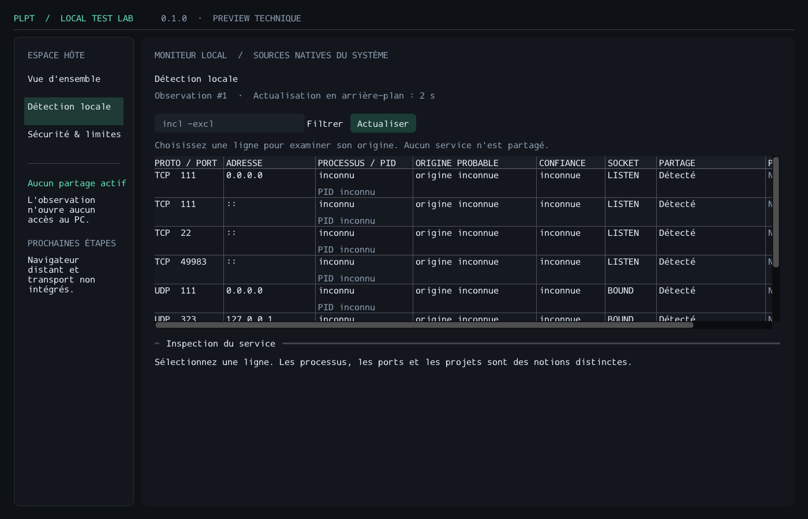

> **HISTORICAL / SUPERSEDED:** this report describes the original CMake-based preview, not the current build architecture. See [DIRECT_BUILD_MIGRATION.md](DIRECT_BUILD_MIGRATION.md) and the native platform reports. Original logs remain historical evidence.

# PLPT — rapport de livraison et preuves

**2026-11-13 · 0.1.0-preview · C++20 / clang++**

## 1. Conclusion

Un **moniteur local réel** CLI et SDL3/ImGui est compilé et exécuté sous Linux.
Le socle, les adaptateurs Windows et les modèles locaux anticipés sont livrés en
source. **PLPT ne partage pas encore d'application.** Il n'y a ni connexion invitée,
ni WebView2 opérationnel, ni authentification/QUIC, ni scénario Wi-Fi à cinq PC.

La cible prioritaire **Windows x64 n'a pas été liée ni exécutée dans ce sandbox**.
Une vérification syntaxique Windows porte sur 16 unités ; elle ne constitue pas
une qualification Microsoft SDK/STL ou un substitut à une machine Windows.

| Élément | État constaté |
|---|---|
| Cœur Linux Debug / Release / ASan+UBSan | **5/5 entrées CTest réussies dans chaque configuration** |
| UI Linux `dummy`/software Debug | **7/7 réussies** |
| UI Linux `dummy`/software + ASan/UBSan | **7/7 réussies après correction d'une fuite du chemin BMP** |
| Headers autonomes Linux | **20/20 compilés séparément** |
| Windows x64, headers MinGW/libc++ | **16/16 unités passent `-fsyntax-only`** ; aucun lien ni run |
| Fuzzing du codec | **20 000 exécutions**, aucune erreur détectée dans ce run court |
| Répétition suite unitaire ASan | **25 répétitions sans échec** |
| Archive Linux CLI / staging UI | TGZ extrait, binaire comparé et exécuté ; UI installée testée |
| CI Windows-first | Fichier fourni ; **aucun push, workflow ou résultat GitHub exécuté ici** |
| Installateur Windows | Script/recette NSIS et manifeste fournis ; **non compilés, non exécutés, non signés** |
| Lots E–I / V1 LAN | **Non validés** |

Les gates du maître restent ouverts : un modèle unitaire de cinq participants
n'est pas cinq navigateurs isolés et cinq PC connectés. Cette livraison est un
incrément de fondation/moniteur, pas la réalisation complète du scénario directeur.

## 2. Périmètre et décisions

Rapports par lot : [A](LOT_A.md), [B](LOT_B.md), [C](LOT_C.md), [D](LOT_D.md).
Le Lot A signale honnêtement que son rapport formel a été rédigé **après** des
premiers changements ; l'ordre strict du maître §26 n'avait donc pas été respecté.
Cette réserve n'a pas été effacée de l'historique documentaire.

Fichiers principaux créés/modifiés :

- CMake/presets, `build.bat`, `build.sh`, `cmake/Desktop.cmake` ;
- `engine/core`, `platform/{windows,linux}`, `discovery`, `service_registry` ;
- CLI `app/host_shell/main.cpp`, UI `app/desktop_ui/main.cpp` ;
- prototypes testés `port_allocator`, `session`, `messaging`, `protocol`,
  `resource_manager`, `diagnostics` ; interfaces navigateur/stockage/transport ;
- suites unitaires, OS, arguments, erreurs UI et fuzz ; outils de vérification ;
- `.github/workflows/build.yml`, `packaging/windows`, `tools/package-windows.ps1` ;
- README, architecture, sécurité, compilation, tests, ADR, protocole, roadmap,
  inventaire des dépendances et notices de licence.

`plpt_models` n'est lié **ni au moniteur CLI ni à l'UI**, et n'est pas installé.
Faux transport, empreinte FNV d'invitation et sweep récursif par préfixe ont été
retirés. La sélection est locale : aucune transition n'active un partage.

Décisions : [registre ADR](../ADR/README.md), [ADR-011](../ADR/ADR-011-proof-gates.md),
[ADR-012](../ADR/ADR-012-monitor-renderer.md). Pas de service tiers produit ajouté.
SDL3 3.4.20 / ImGui 1.93.0 sont épinglés par commit **et** SHA-256. Les licences
zlib/MIT sont présentes. Outils/provenance/risques : [inventaire](../../third_party/DEPENDENCIES.md).
La licence de distribution de PLPT reste une décision du propriétaire.

## 3. Environnement réellement employé

Voir [environment.log](evidence/2026-11-13/environment.log) et
[compiler.txt](evidence/2026-11-13/compiler.txt).

- Debian GNU/Linux **12**, x86_64, noyau **6.1.158+**, glibc **2.36**.
- clang++ **22.1.8**, LLVM commit `ca7933e47d3a3451d81e72ac174dcb5aa28b59d1`.
- CMake **3.31.6** ; Ninja package PyPI **1.11.1.4**, binaire affichant
  **`1.11.1.git.kitware.jobserver-1`** ; Python **3.11.2**.
- Headers libstdc++ du toolset Debian **12.2.0** ; **GCC ne compile pas PLPT**.
- Cross-check : headers Zig **0.14.1**, target `x86_64-w64-windows-gnu`.
- Pas de Windows, SDK Microsoft, WebView2, bureau/GPU interactif ni cinq machines Wi-Fi.

Les assets LLVM-MinGW de release n'ont pas pu être téléchargés (TLS, exit 35).
Le clang du sandbox vient donc de packages npm LLVM épinglés 22.1.8, installés avec
scripts désactivés ; provenance secondaire documentée, pas le canal recommandé pour
une release Windows. CMake/Ninja/Zig sont provisionnés hors Git. Aucun de ces outils
n'est requis chez un futur invité.

Branche inchangée : **`arena/9d0968ca-local-test-share`** ; base/HEAD initial
`8845b2dd05e38321fcb78ddd6d42cb3d597788f7`. Pas de commit ni de push pendant cette
livraison. La demande `dev` n'a pas été appliquée : la branche de session est fixe.
Les fichiers modifiés/non suivis sont le livrable ; les hashes des entrées de build
archivés avec les preuves identifient le code testé malgré l'absence de nouveau commit.

Copie du maître vérifiée identique à l'upload :
`25e6fac9e2ddf081ccdfe6d0a8542a12ea2406499cbf840b3aee581373b47b39`.

## 4. Commandes exécutées — cœur

À la racine du dépôt, environnement effectif :

```bash
export PATH="/home/user/.cache/plpt-tools/llvm/node_modules/llvm-runtime-clang-linux-x64/bin:/home/user/.cache/plpt-tools/python/cmake/data/bin:/home/user/.cache/plpt-tools/python/bin:$PATH"

cmake --preset clang-debug
cmake --build --preset clang-debug --parallel 4
ctest --preset clang-debug -V

cmake --preset clang-release
cmake --build --preset clang-release --parallel 4
ctest --preset clang-release -V
out/build/clang-release/plpt-monitor

cmake --preset clang-asan
cmake --build --preset clang-asan --parallel 4
ctest --preset clang-asan -V

ctest --test-dir out/build/clang-asan -R '^unit$' --repeat until-fail:25 --output-on-failure
python3 tools/check_headers.py
./build.sh clang-release
```

Sorties utiles actuelles, identiques pour les trois suites métiers :

```text
unit: 26 cases, 12449 checks, 0 failures (0 failed cases)
platform: 6 cases, 284 checks, 0 failures (0 failed cases)
ipv6: 2 cases, 41 checks, 0 failures (0 failed cases)
100% tests passed, 0 tests failed out of 5
```

Soit **34 cas / 12 774 checks**, plus `cli-version` et les cinq contrats
`cli-arguments`. Ne pas multiplier ces chiffres par le nombre de configurations
pour annoncer une couverture fonctionnelle artificiellement plus grande. **IPv6 a
réellement tourné**, il n'a pas été marqué SKIP dans cet environnement.

Logs : [Debug](evidence/2026-11-13/tests-debug.log),
[Release](evidence/2026-11-13/tests-release.log),
[ASan](evidence/2026-11-13/tests-asan.log),
[répétitions](evidence/2026-11-13/worker-repeat-asan.log),
[headers](evidence/2026-11-13/headers.log),
[wrapper](evidence/2026-11-13/wrapper-release.log).

Le refus de g++ est exécuté et vérifié : configuration avec
`-DCMAKE_CXX_COMPILER=g++`, exit **1**, diagnostic `PLPT requires LLVM clang++`.
`./build.sh not-a-preset` retourne **2**, comme attendu. Ce sont des tests négatifs
réussis, pas des compilations échouées dissimulées.

Inventaire réel :

```text
Aucun partage actif. Aucun listener PLPT ouvert.
8 groupe(s) de services observés. Un PID inconnu reste inconnu.
```

[Sortie complète](evidence/2026-11-13/monitor-live.log). Le chiffre 8 est celui du
sandbox au moment de l'exécution, pas une fixture ni une attente à reproduire sur
un autre poste. Les tests OS ouvrent leurs propres sockets sur **port zéro** et
vérifient l'exclusivité ; le moniteur ne réserve aucun socket de partage.

## 5. UI exécutée et capture réelle

```bash
cmake -S . -B out/build/ui-smoke -G Ninja \
  -DCMAKE_CXX_COMPILER=clang++ -DCMAKE_C_COMPILER=clang \
  -DCMAKE_BUILD_TYPE=Debug -DPLPT_BUILD_UI=ON -DPLPT_HEADLESS_UI=ON
cmake --build out/build/ui-smoke --parallel 4
ctest --test-dir out/build/ui-smoke -V

cmake -S . -B out/build/ui-asan -G Ninja \
  -DCMAKE_CXX_COMPILER=clang++ -DCMAKE_C_COMPILER=clang \
  -DCMAKE_BUILD_TYPE=Debug -DPLPT_BUILD_UI=ON -DPLPT_HEADLESS_UI=ON -DPLPT_SANITIZE=ON
cmake --build out/build/ui-asan --parallel 4
ctest --test-dir out/build/ui-asan -V
SDL_VIDEODRIVER=dummy SDL_RENDER_DRIVER=software \
  out/build/ui-asan/plpt-desktop --smoke-test --screenshot out/evidence/desktop.bmp
```

Résultat des deux configurations :

```text
desktop-smoke: 8 frames, snapshot=1, services=8, sharing=disabled
-- PASS unknown-argument: exit 2
-- PASS missing-screenshot-argument: exit 2
-- PASS capture-requires-smoke: exit 2
-- PASS video-driver-unavailable: exit 1
-- PASS screenshot-write-failure: exit 1
-- PASS screenshot-disk-full: exit 1
100% tests passed, 0 tests failed out of 7
```

[Tests UI](evidence/2026-11-13/tests-ui.log) ·
[UI ASan après correction](evidence/2026-11-13/tests-ui-asan.log) ·
[capture réussie](evidence/2026-11-13/desktop-capture.log).



PNG obtenu par conversion sans retouche du BMP de l'application avec Pillow 11.3.0.
Capture visuellement revue : marges corrigées, navigation et table rendues, label
latéral lisible. La table conserve volontairement un scroll horizontal. Aucun
clic utilisateur, IME, DPI multi-écran, renderer Windows/GPU ou navigateur distant
n'est validé par cette image. Pas de mockup généré ni de capture du bureau complet.

### Échec réel détecté et corrigé

Le premier run UI ASan donne **6/7**, avec :

```text
ERROR: LeakSanitizer: detected memory leaks
SUMMARY: AddressSanitizer: 3780400 byte(s) leaked in 2 allocation(s).
```

[Log initial intégral](evidence/2026-11-13/tests-ui-asan-initial.log).
Le test `desktop-errors` rejette tout diagnostic sanitizer même si le code attendu
est 1. La trace et la lecture de `SDL_bmp.c` au commit épinglé montrent la surface
intermédiaire retenue par `SDL_SaveBMP` si `SDL_IOFromFile` échoue.

Correction dans **notre appelant**, sans modifier SDL ni supprimer LeakSanitizer :
`SDL_IOFromFile`, surface/flux en RAII, `SDL_SaveBMP_IO(..., false)` et vérification
explicite de `SDL_CloseIO`. Re-tests fichier impossible, `/dev/full` et capture
réussie passent sans diagnostic. Le risque et le test à rejouer lors des mises à
jour SDL sont enregistrés dans l'inventaire des dépendances.

ASan/UBSan instrumentent notre code. SDL/ImGui ne sont pas intégralement compilés
avec ces flags ; LSan intercepte néanmoins leurs allocations. Aucune promesse
d'audit complet des dépendances n'est déduite de ce run.

## 6. Windows : vérification additionnelle exécutée

```bash
python3 tools/check_windows_syntax.py \
  --clang /home/user/.cache/plpt-tools/llvm/node_modules/llvm-runtime-clang-linux-x64/bin/clang++ \
  --zig-lib /home/user/.cache/plpt-tools/zig/ziglang/lib \
  --sdl-root /home/user/.cache/plpt-tools/sources/SDL-f00dc919ca35b9756316e86c4777392de442f9b2 \
  --imgui-root /home/user/.cache/plpt-tools/sources/imgui-c1aaac65e896a45f81f47a4d68f9959e0f86c859
```

```text
PASS: 16 translation units; native Windows build and tests still required.
```

[Commande développée et liste des unités](evidence/2026-11-13/windows-syntax.log).
Couvre les trois adaptateurs natifs (provider, allocator, RNG), le cœur, les modèles,
les deux applications et les tests compilables sous Windows.

Tentatives précédentes conservées :

- Probe via `zig c++` : `FileNotFound` après génération d'archives runtime ;
  [log](evidence/2026-11-13/zig-include-probe.log), approche non retenue.
- Premier script Clang complet : libc++ du sysroot n'exposait pas `std::jthread` /
  `std::stop_token` ; [log](evidence/2026-11-13/windows-syntax-initial.log).
- Drapeau **du seul cross-check** `-fexperimental-library` : les types sont déclarés,
  les 16 unités passent. Pas de remplacement de jthread ni de baisse du standard.

Ce check ne valide **pas** CMake Windows, le driver/ABI Microsoft, les import libs,
les manifestes, les DLL, les accès OS, la qualité UI ou NSIS. JSON/XML des presets et
du manifeste sont parsés localement ; le manifeste est transmis au linker par
CMake (`.manifest` source, `/MANIFESTINPUT`), sans ressource 1/24 dupliquée.

## 7. Fuzzing du codec

```bash
cmake --preset clang-fuzz
cmake --build --preset clang-fuzz --target plpt-fuzz-envelope --parallel 4
python3 tools/seed_fuzz_corpus.py out/fuzz/final-corpus
out/build/clang-fuzz/plpt-fuzz-envelope -runs=20000 -seed=20261113 \
  -max_len=4096 -timeout=2 -artifact_prefix=out/fuzz/ out/fuzz/final-corpus
```

```text
#20000 DONE cov: 573 ft: 774 corp: 26/1438b lim: 219 exec/s: 0 rss: 44Mb
Done 20000 runs in 0 second(s)
```

[Log brut](evidence/2026-11-13/fuzz.log) (la sortie réelle utilise des tabulations).
Aucun crash ni diagnostic détecté. `0 second(s)` est l'arrondi de libFuzzer,
pas une mesure de débit PLPT. Fuzz court, entrées limitées à 4096 octets ; pas
campagne exhaustive, pas parser QUIC incrémental et pas validation du transport.
Le corpus et les gros outputs de build restent sous `out/`, hors Git.

## 8. Packaging de développement

**Staging et TGZ Linux CLI générés et vérifiés.** Commandes exécutées :

```bash
cmake --install out/build/clang-release --prefix out/stage-linux
cpack --config out/build/clang-release/CPackConfig.cmake -B out/packages
python3 tools/check_linux_package.py \
  out/packages/PLPT-0.1.0-preview-Linux-x64.tar.gz out/build/clang-release/plpt-monitor
cmake --install out/build/ui-smoke --prefix out/stage-ui
SDL_VIDEODRIVER=dummy SDL_RENDER_DRIVER=software out/stage-ui/bin/plpt-desktop --smoke-test
```

[CPack](evidence/2026-11-13/package-linux.log) ·
[vérification du TGZ](evidence/2026-11-13/package-check.log) ·
[UI depuis staging](evidence/2026-11-13/stage-ui-smoke.log).
Le checker extrait dans un dossier de test possédé, refuse chemins traversants et
liens, vérifie la présence des docs, l'absence de tests/modèles/GUI dans le package
CLI, puis compare le binaire au Release testé **avant** de l'exécuter. `--version`
et inventaire réel réussissent. Aucun symbole `plpt::model::` n'est présent dans
le moniteur. Le hash/taille du TGZ et les dépendances `ldd` sont dans le log.
L'UI installée rend également ses huit frames ; les licences principales et notices embarquées sont
comparées aux fichiers sources. Le profil UI `dummy` n'est pas proposé comme package desktop.

L'archive technique reste dans `out/packages`, hors Git ; elle se régénère par ces
commandes. Ce test local ne prouve pas la portabilité glibc entre distributions,
et l'archive n'est ni un installateur Linux universel ni une release V1.

Le ZIP Windows, l'installateur NSIS 3.11, l'installation/désinstallation, la signature
et SmartScreen ne sont **pas exécutés** ici. Scripts et instructions dans
[BUILD.md](../BUILD.md). Le packaging n'introduit ni service, ni pare-feu automatique,
ni élévation ; ces intentions doivent encore être vérifiées sur Windows.

## 9. Autres corrections et limites

- Compilation initiale stricte refusée : cinq agrégats de tests incomplets et une
  copie de string en range-loop. Corrigés sans retirer `-Werror` ;
  [log initial](evidence/2026-11-13/build-debug-initial.log) conservé.
- Revue des observations : la première lecture de processus perdait ses warnings,
  et la complétude des processus n'arrivait pas au registre. Le registre reçoit
  désormais **les deux `Observation`**, CLI et worker compris. Nouvelles régressions
  partiel/échec/récupération, capacité et queue ; pas d'autorisation conservée.
- Les tombstones d'observations partielles répétées sont bornées, pas d'historique
  indisponible croissant indéfiniment.
- Estimations CPU/RAM : non calibrées, aucun benchmark de streaming ici.
- L'audit est désactivé par défaut ; aucune affirmation « zéro écriture sur disque ».
  Pas de preuve d'effacement SSD/pagefile/dumps, pas de backend de profils qualifié.
- Fermeture d'un worker système : attente de fin de l'appel OS en cours, pas
  d'annulation magique. Pas de profilage CPU en arrière-plan.
- Les règles du modèle ne deviennent pas une autorisation réseau. Pas de couverture
  des handlers authentifiés, puisqu'ils n'existent pas encore.

## 10. Conditions de passage suivantes

1. **Compiler/lier/exécuter sous Windows x64** avec clang++ + SDK/STL Microsoft ;
   matrice Next/Vite/PowerShell/IDE/Docker/WSL2, accès refusés, Unicode et churn.
2. Qualifier l'UI native (clavier, focus, DPI, multi-écran) et le package sur VM propre.
3. Prototyper **WebView2 / surface dédiée / capture / input sans voler le focus**,
   profils isolés et origines strictes. Échec d'une garantie = décision d'architecture,
   pas fallback vers accès bureau/clavier système.
4. Seulement ensuite : pile QUIC maintenue, handshake/invitations, véritables invités,
   puis audit de nettoyage, sécurité et mesures cinq PC Wi-Fi.

Voir [roadmap](../ROADMAP.md) et [plan de test](../TESTING.md).
Les preuves compactes (logs + PNG) sont archivées dans le dépôt, indépendamment
de `out/` et des caches exclus des snapshots. Leur intégrité n'est pas une signature
ni une certification indépendante ; c'est la traçabilité d'une exécution de développement.
